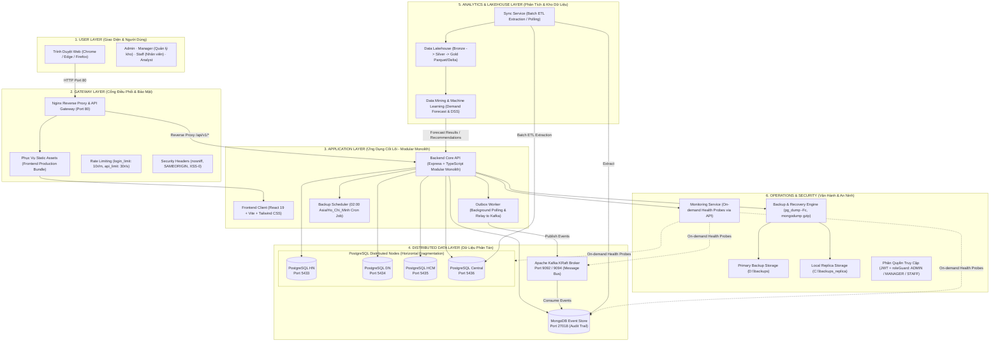

# THIẾT KẾ KIẾN TRÚC HẠ TẦNG: DISTRIBUTED MODULAR MONOLITH
## DỰ ÁN HỆ THỐNG QUẢN TRỊ KHO PHÂN TÁN (WAREHOUSE DSS)

---

## 1. TỔNG QUAN ĐỊNH HƯỚNG KIẾN TRÚC

Hệ thống Warehouse DSS áp dụng mô hình kiến trúc **Distributed Modular Monolith kết hợp Multi-Database, Event-Driven Communication và Central Data Center**:
- **Bản chất phân tán (Distributed Data):** Dữ liệu phân mảnh ngang theo chi nhánh địa lý (Hà Nội, Đà Nẵng, TP.HCM) và được hợp nhất/điều phối tại Trung tâm Dữ liệu (Central Data Center). Mỗi kho vận hành một cơ sở dữ liệu quan hệ độc lập. Giao tiếp liên kho và đồng bộ dữ liệu sử dụng mô hình Event-Driven qua Apache Kafka, Outbox Polling Worker và Saga Transaction Pattern (không dùng cơ chế PostgreSQL Streaming Replication vật lý).
- **Bản chất Modular Monolith:** Toàn bộ logic nghiệp vụ (Auth, Inventory, Transfer, Dashboard, Monitoring, Backup) được đóng gói trong một ứng dụng Backend duy nhất (Express + TypeScript) có ranh giới module rõ ràng, thay vì phân tách thành hàng chục microservice rời rạc.
- **Tính khả thi và tối ưu vận hành:** Cân bằng hoàn hảo giữa yêu cầu kỹ thuật của môn học Hệ thống Phân tán, khả năng vận hành mượt mà trên một máy tính cá nhân (1 laptop với Docker Compose), và giảm thiểu tối đa độ phức tạp khi gỡ lỗi, kiểm thử và bảo trì.

---

## 2. KIẾN TRÚC HẠ TẦNG 6 TẦNG LOGIC (6-LAYER LOGICAL ARCHITECTURE)

> [!NOTE]
> 6 tầng dưới đây là các **tầng phân chia logic** về mặt kiến trúc phần mềm và luồng dữ liệu, không có nghĩa là 6 hệ thống hạ tầng vật lý độc lập. Trên môi trường máy tính cá nhân/máy chủ demo, toàn bộ được điều phối tập trung thông qua Docker Compose và Nginx Gateway.



---

## 3. PHÂN ĐỊNH CHI TIẾT TRÁCH NHIỆM 6 TẦNG LOGIC

| Tầng Logic | Thành phần | Công nghệ | Trách nhiệm chính & Bản chất triển khai thực tế |
|---|---|---|---|
| **1. User Layer** | Web Browser | HTML5, CSS3, JavaScript | Điểm tương tác của người dùng cuối theo vai trò (ADMIN, Quản lý kho, Nhân viên kho, Chuyên viên phân tích). |
| **2. Gateway Layer** | Nginx Gateway | Nginx Alpine, Docker | Điểm vào duy nhất (Single Entrypoint) tại cổng 80: Phục vụ trực tiếp tệp tĩnh Frontend; định tuyến `/api/v1/*` về Backend; kiểm soát tần suất request (Rate Limiting); thiết lập HTTP Security Headers. |
| **3. Application Layer** | Frontend SPA<br>Backend API<br>Workers & Jobs | React 19, TypeScript<br>Express, TypeScript<br>KafkaJS, Node.js | - **Frontend:** Giao diện quản lý kho, nhập/xuất, điều chuyển liên chi nhánh, bảng điều hành giám sát (`/monitoring`) và màn hình sao lưu/phục hồi (`/backup`).<br>- **Backend Modular Monolith:** Tiếp nhận request, xác thực JWT, kiểm tra phân quyền RBAC, điều phối giao dịch nghiệp vụ.<br>- **Outbox Worker:** Quét định kỳ bảng `outbox_event` tại các chi nhánh (Outbox Polling mỗi 3 giây) và xuất bản lên Kafka.<br>- **Backup Scheduler:** Chạy tác vụ sao lưu tự động định kỳ lúc 02:00 (Asia/Ho_Chi_Minh). |
| **4. Distributed Data Layer** | 4 PostgreSQL Nodes<br>MongoDB Event Store<br>Apache Kafka | PostgreSQL 18<br>MongoDB 8<br>Kafka 3.8.0 (KRaft) | - **3 Node Kho (HN, DN, HCM):** Phân mảnh dữ liệu ngang theo địa lý (Horizontal Data Fragmentation). Mỗi kho lưu trữ dữ liệu tồn kho, nhập xuất và bảng Outbox cục bộ.<br>- **Central Database:** Lưu trữ dữ liệu tổng hợp toàn quốc và giao dịch Saga điều chuyển.<br>- **MongoDB:** Lưu vết toàn bộ sự kiện nghiệp vụ (Audit Trail & Event Log).<br>- **Kafka:** Trục truyền thông điệp bất đồng bộ đảm bảo tính nhất quán cuối cùng (Eventual Consistency).<br>*(Lưu ý: Không sử dụng cơ chế PostgreSQL Streaming Replication vật lý mà đồng bộ qua kiến trúc hướng sự kiện Event-Driven)*. |
| **5. Analytics Layer** | Data Lakehouse<br>Machine Learning<br>ETL Sync Service | Parquet, Delta Lake<br>Scikit-Learn, LightGBM<br>Python, Pandas | - **Data Lakehouse:** Lưu trữ dữ liệu phân tầng Bronze (dữ liệu thô), Silver (làm sạch/chuẩn hóa) và Gold (tập dữ liệu phân tích).<br>- **Data Mining:** Mô hình dự báo nhu cầu xuất kho (Ridge, Random Forest, LightGBM) và đề xuất điều chuyển hàng tối ưu.<br>- **ETL Sync Service:** Trích xuất dữ liệu định kỳ theo lô (Batch ETL Extraction mỗi 300 giây) từ Central Database và MongoDB vào Data Lakehouse (không phải CDC cấp log máy chủ). |
| **6. Operations & Security** | Monitoring<br>Backup & Recovery<br>Storage Volumes | Node.js Probes<br>pg_dump, mongodump<br>Ổ đĩa D: và C: | - **Monitoring:** Kiểm tra chủ động theo yêu cầu (On-demand Health Probes qua API) đo độ trễ mạng, trạng thái kết nối 4 DB, MongoDB, Kafka, cảnh báo lỗi Outbox backlog.<br>- **Backup & Recovery:** Tạo bản dump nhị phân nén (PostgreSQL Custom format, MongoDB gzip archive), mã băm SHA-256, bản sao lưu cục bộ (Local Replica tại `C:\backups_replica` trên cùng máy vật lý), chặn tuyệt đối Restore vào Production, phục hồi an toàn vào DB test. |

---

## 4. MA TRẬN PHÂN NHÓM CONTAINER HẠ TẦNG (DOCKER COMPOSE)

Để tối ưu hóa tài nguyên trên máy tính cá nhân (1 laptop), hạ tầng được tổ chức thành các nhóm logic rõ ràng:

| Nhóm | Tên Container | Image | Ports Host | Mục đích |
|---|---|---|---|---|
| **Edge / Gateway** | `warehouse_nginx` | `nginx:alpine` | `80:80` | Entrypoint toàn hệ thống, phục vụ Static UI và điều phối Reverse Proxy. |
| **Application** | `warehouse_backend` *(hoặc chạy Host dev)*<br>`warehouse_outbox_worker` | Node.js 20 / TS<br>Node.js 20 / TS | `5000:5000`<br>Internal | Lõi API, điều phối nghiệp vụ, background outbox poller. |
| **Distributed Data** | `warehouse_postgres_hn`<br>`warehouse_postgres_dn`<br>`warehouse_postgres_hcm`<br>`warehouse_postgres_central` | `postgres:18`<br>`postgres:18`<br>`postgres:18`<br>`postgres:18` | `5433:5432`<br>`5434:5432`<br>`5435:5432`<br>`5436:5432` | 4 cơ sở dữ liệu quan hệ độc lập (3 chi nhánh kho phân mảnh + 1 trung tâm điều hành). |
| **Event & Messaging**| `warehouse_mongodb`<br>`warehouse_kafka` | `mongo:8`<br>`apache/kafka:3.8` | `27018:27017`<br>`9092, 9094` | Event Store lưu vết kiểm toán và KRaft Event Broker. |
| **Analytics & Sync** | `warehouse_sync_service` | Python 3.11 | Internal | Dịch vụ trích xuất định kỳ (Batch ETL Extraction) đồng bộ dữ liệu vào Data Lakehouse. |
| **Storage & Volumes**| *(Docker Volumes)* | Named Volumes | Filesystem | `postgres_hn_data`, `dn_data`, `hcm_data`, `central_data`, `mongodb_data`, `kafka_data`. |

---

## 5. ĐỐI CHIẾU CẤU TRÚC CODE HIỆN TẠI VÀ MÔ HÌNH MỤC TIÊU (GAP ANALYSIS)

### 5.1. Bảng Đối Chiếu Cấu Trúc Thư Mục

| Thư mục mục tiêu | Thư mục hiện tại | Đánh giá hiện trạng | Hành động chuẩn hóa khuyến nghị |
|---|---|---|---|
| `frontend/src/...` | `frontend/src/...` | **ĐÃ KHỚP 100%** | Đã phân tách đầy đủ `components`, `pages`, `services`, `types`, `App.tsx`. Không thay đổi. |
| `nodes/hn/`, `dn/`, `hcm/` | `nodes/node_hn/`, `node_dn/`, `node_hcm/` | **ĐÃ CÓ SẴN (Cấu hình Runtime)** | Thư mục `nodes/node_*` là nguồn mount runtime của Docker Compose. Thư mục `nodes/hn, dn, hcm` là cấu trúc định hướng (xem lưu ý bên dưới). |
| `data_center/` | `data_center/` | **ĐÃ KHỚP 100%** | Đã chứa `central_database/` (7 file SQL), `data_lake/` (`bronze`, `silver`, `gold`), `etl/`. |
| `mongodb/init/` | `mongodb/` | **ĐÃ CÓ SẴN (Cấu hình Runtime)** | Thư mục `mongodb/` chứa các file JS khởi tạo trực tiếp cho Docker Compose. Thư mục `mongodb/init/` là cấu trúc định hướng. |
| `data_mining/` | `data_mining/` | **ĐÃ CÓ SẴN HOÀN CHỈNH** | Đã chứa đầy đủ datasets, models, pipelines và báo cáo đánh giá. |
| `nginx/` | `nginx/` | **ĐÃ KHỚP 100%** | Đã có `nginx.conf` với rate limiting và proxy pass hoàn chỉnh. |
| `backend/src/` | `backend/src/` | **HOẠT ĐỘNG ỔN ĐỊNH** | Tổ chức theo Layered (`controllers/`, `services/`, `repositories/`, `routes/`, `workers/`, `kafka/`). Đã bổ sung 8 file Barrel Facade (`modules/`, `infrastructure/`) định hướng mà không can thiệp luồng chạy. |

> [!IMPORTANT]
> **LƯU Ý VỀ RUNTIME DOCKER VÀ THƯ MỤC CẤU HÌNH:**
> - Các thư mục `nodes/hn/`, `nodes/dn/`, `nodes/hcm/` và `mongodb/init/` được tạo ra như các **cấu trúc định hướng (directional templates/facade)** nhằm mục đích tổ chức tài liệu và chuẩn hóa kiến trúc dài hạn.
> - **Cấu hình runtime thực tế của hệ thống**: File `docker-compose.yml` hiện tại và các container Docker đang chạy **vẫn gắn kết (mount volume) chặt chẽ với các thư mục gốc**:
>   + `nodes/node_hn/` -> `/docker-entrypoint-initdb.d/` của `warehouse_postgres_hn`
>   + `nodes/node_dn/` -> `/docker-entrypoint-initdb.d/` của `warehouse_postgres_dn`
>   + `nodes/node_hcm/` -> `/docker-entrypoint-initdb.d/` của `warehouse_postgres_hcm`
>   + `mongodb/*.js` -> `/docker-entrypoint-initdb.d/` của `warehouse_mongodb`
> - **Quy tắc bất biến:** Không thay đổi các volume mount trong `docker-compose.yml` và không xóa các thư mục gốc để đảm bảo hệ thống container không bị gián đoạn hoặc gặp lỗi khởi tạo cơ sở dữ liệu.

---

## 6. THỰC HIỆN TỔ CHỨC MODULAR MONOLITH & FACADE RE-EXPORTS

Nhằm chuẩn hóa kiến trúc mã nguồn Backend theo hướng Modular Monolith mà không gây xáo trộn hoặc làm gãy các luồng nghiệp vụ đang hoạt động, hệ thống đã triển khai 8 tệp Barrel Re-export (Facade):

1. `backend/src/modules/auth/index.ts`: Re-export controller, service, routes liên quan đến xác thực và phân quyền RBAC.
2. `backend/src/modules/inventory/index.ts`: Re-export nghiệp vụ quản lý sản phẩm, tồn kho và phiếu kho.
3. `backend/src/modules/transfer/index.ts`: Re-export nghiệp vụ điều chuyển liên kho, Saga Orchestration và Outbox.
4. `backend/src/modules/dashboard/index.ts`: Re-export tổng hợp dữ liệu điều hành và báo cáo tổng quan.
5. `backend/src/modules/monitoring/index.ts`: Re-export giám sát trạng thái node, kết nối và cảnh báo.
6. `backend/src/modules/backup/index.ts`: Re-export sao lưu, phục hồi dữ liệu và lập lịch tự động.
7. `backend/src/infrastructure/postgres/index.ts`: Re-export kết nối 4 database pool PostgreSQL.
8. `backend/src/infrastructure/kafka/index.ts`: Re-export Kafka Producer và Consumer client.

> [!NOTE]
> **Đặc tính an toàn:** Các tệp Barrel Re-export này đóng vai trò là ranh giới module logic (facade). Ứng dụng runtime (`app.ts`) và các bộ kiểm thử hiện tại tiếp tục import từ các đường dẫn phân lớp ổn định (`services/`, `controllers/`, `routes/`, `kafka/`), bảo đảm tính tương thích 100%, không sinh lỗi phụ thuộc vòng tròn (Circular Dependency) và vượt qua kiểm tra TypeScript (`tsc --noEmit`).

---

## 7. CÁCH DIỄN GIẢI KIẾN TRÚC KHI BẢO VỆ ĐỒ ÁN (THESIS DEFENSE SCRIPT)

Khi trình bày hoặc giải thích kiến trúc với Giảng viên và Hội đồng chấm điểm, cần tuân thủ cấu trúc phân tầng rõ ràng và mô tả trung thực bản chất kỹ thuật:

### 7.1. Sơ đồ Tóm Tắt Trình Bày
```
[User & Gateway]
  Browser (Web Client) ──> Nginx API Gateway (Port 80, Reverse Proxy, Rate Limit)

[Backend Modular Monolith]
  Backend Express + TypeScript (Port 5000)
  ├── Modules: Auth · Inventory · Transfer/Saga · Monitoring · Backup
  └── Background: Outbox Polling Worker · Backup Scheduler (Cron Job)

[Distributed Data Layer]
  ├── 3 Kho Chi Nhánh: PostgreSQL HN (5433) · DN (5434) · HCM (5435) [Phân mảnh ngang]
  ├── Trung Tâm Điều Hành: PostgreSQL Central (5436) [Tổng hợp dữ liệu]
  ├── Event Store: MongoDB (27018) [Lưu vết kiểm toán & Event Sourcing]
  └── Message Broker: Apache Kafka KRaft (9092/9094) [Đồng bộ bất đồng bộ]

[Analytics Layer]
  Python Sync Service (Batch ETL Extraction) ──> Data Lakehouse (Bronze/Silver/Gold) ──> ML/DSS

[Operations & Security]
  On-demand Health Probes · pg_dump/mongodump Backup & Safe Restore · Local Replica (C:) · RBAC
```

### 7.2. Câu Thuyết Minh Trọng Tâm (Key Thesis Statement)
> *"Hệ thống sử dụng một Backend Modular Monolith để quản lý các nghiệp vụ theo module, nhưng dữ liệu được phân tán trên nhiều PostgreSQL instance theo từng kho. Các node giao tiếp và đồng bộ thông qua Saga, Outbox Polling và Kafka. Central Data Center đảm nhiệm điều phối và tổng hợp dữ liệu, không thay thế các kho nghiệp vụ độc lập."*

### 7.3. Các Luận Điểm Trả Lời Câu Hỏi Kỹ Thuật Chuyên Sâu
1. **Tại sao không chia thành hàng chục microservice?**
   - *Trả lời:* Đồ án hướng tới giải quyết bài toán cốt lõi của môn học là **Tính phân tán của Dữ liệu** (Distributed Data, Data Fragmentation, Eventual Consistency, Saga Pattern, Disaster Recovery). Việc áp dụng Modular Monolith giúp tập trung vào phân tán dữ liệu và giao dịch phân tán, tránh lãng phí tài nguyên máy tính vào mạng lưới microservice ảo và overhead giao tiếp RPC nội bộ.
2. **Hệ thống đồng bộ dữ liệu bằng cơ chế nào? Có phải CDC hay Database Replication không?**
   - *Trả lời:* Hệ thống đồng bộ dữ liệu giao dịch thông qua **Outbox Polling Worker** (quét bảng `outbox_event` mỗi 3s) và **Apache Kafka** để đảm bảo tính nhất quán cuối cùng (Eventual Consistency) và Saga Pattern. Quá trình nạp dữ liệu phân tích sang Data Lakehouse sử dụng **Batch ETL Extraction** định kỳ (mỗi 300s). Hệ thống không dùng cơ chế PostgreSQL Streaming Replication cấp nhị phân và không dùng CDC cấp WAL log (như Debezium).
3. **Bản sao lưu Local Replica tại sao lại đặt ở ổ C: và D:?**
   - *Trả lời:* Hệ thống triển khai chiến lược sao lưu hai cấp cục bộ: Kho chính tại `D:\backups` và bản sao Local Replica tại `C:\backups_replica` kèm kiểm tra toàn vẹn SHA-256 độc lập. Trong môi trường thử nghiệm trên 1 laptop, đây là **Local Replica** giữa hai phân vùng thư mục để chống xóa nhầm tệp. Khi triển khai production thực tế, đường dẫn này sẽ được cấu hình ánh xạ tới kho lưu trữ đám mây (Cloud S3/MinIO) hoặc NAS riêng biệt.
4. **Cơ chế giám sát (Monitoring) hoạt động như thế nào?**
   - *Trả lời:* Chức năng Monitoring sử dụng cơ chế **On-demand Health Probes qua API** (`/api/v1/monitoring/health` và `/db-health`). Khi người dùng truy cập giao diện `/monitoring` hoặc khi hệ thống cần kiểm tra trước/sau khi phục hồi thảm họa, backend sẽ chủ động mở kết nối kiểm tra đồng thời độ trễ mạng và trạng thái của 4 PostgreSQL node, MongoDB, Kafka và Outbox backlog.

---

## 8. KẾT LUẬN & ĐÁNH GIÁ NGHIỆM THU

### 8.1. Bảng Đánh Giá Kết Quả Chuẩn Hóa

| Hạng mục | Kết luận nghiệm thu | Ghi chú & Giới hạn kỹ thuật |
|---|---|---|
| **Distributed Modular Monolith** | **ACCEPT** | Phù hợp tối ưu với đồ án, không chia nhỏ microservice không cần thiết. |
| **Multi-Database & Central Data Center** | **ACCEPT** | Phân mảnh ngang 3 chi nhánh rõ ràng, Central tổng hợp dữ liệu. |
| **Nginx Gateway** | **ACCEPT** | Điểm vào duy nhất tại Port 80, phục vụ Static UI và bảo mật Rate Limit. |
| **8 Barrel Facade Re-exports** | **ACCEPT WITH LIMITATIONS** | Đạt yêu cầu về cấu trúc facade gom nhóm; giữ nguyên mã runtime ổn định. |
| **Cơ chế Đồng bộ Dữ liệu** | **ACCEPT** | Chuẩn hóa thuật ngữ: Outbox Polling & Batch ETL Extraction (không gọi sai là CDC). |
| **Phân tán Cơ sở dữ liệu** | **ACCEPT** | Chuẩn hóa thuật ngữ: Horizontal Data Fragmentation (không gọi sai là DB Replication). |
| **Sao lưu & Bản sao cục bộ** | **ACCEPT** | Chuẩn hóa thuật ngữ: Local Replica (không tuyên bố là sao lưu độc lập vật lý). |
| **Giám sát Sức khỏe Hệ thống** | **ACCEPT** | Chuẩn hóa thuật ngữ: On-demand Health Probes (không tuyên bố là realtime push APM). |
| **Tính Ổn định & Không Hồi Quy** | **100% PASS** | TypeScript Backend/Frontend 0 lỗi; 12/12 bước Fault/Recovery Demo thành công. |

### 8.2. Verdict Cuối Cùng
**ACCEPT WITH LIMITATIONS**
- Nhiệm vụ chuẩn hóa kiến trúc chính thức **ĐÓNG LẠI (FROZEN & STABLE)**.
- Toàn bộ tài liệu kiến trúc đã được đồng bộ chuẩn xác với mã nguồn thực tế.
- Hệ thống sẵn sàng 100% cho việc hoàn thiện báo cáo đồ án và diễn tập kịch bản Demo nghiệm thu trước Hội đồng.
