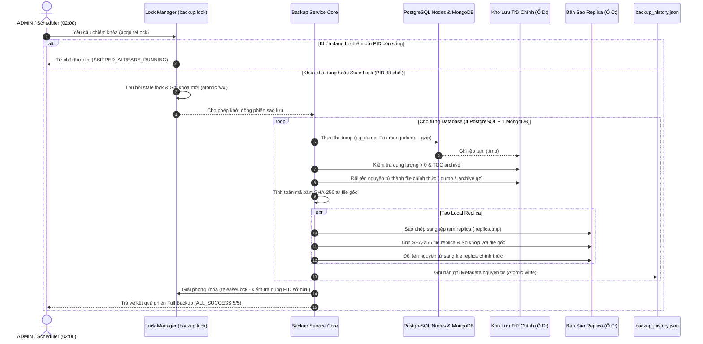
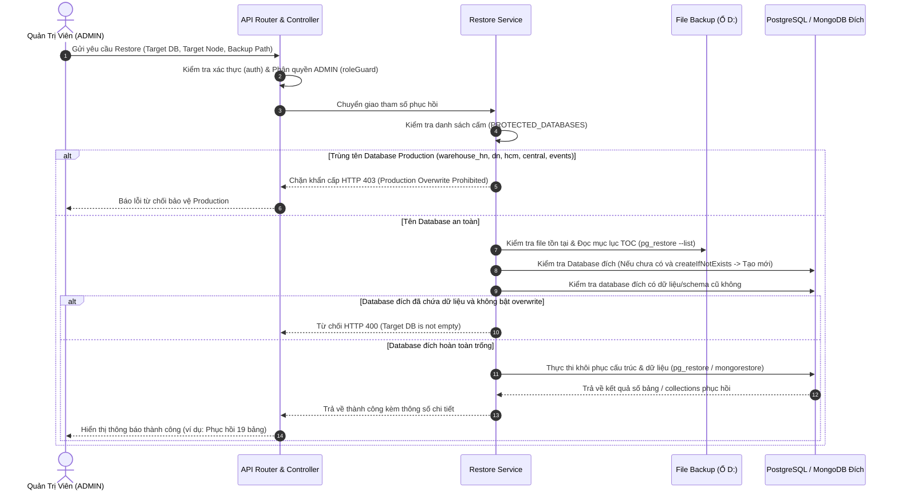
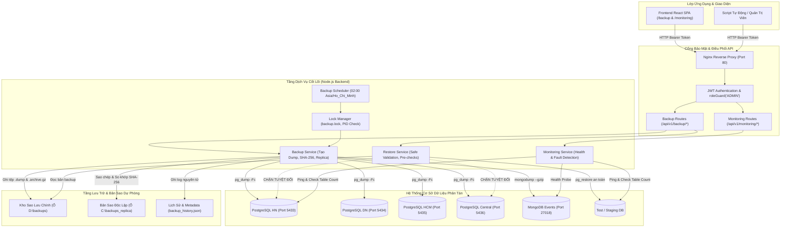
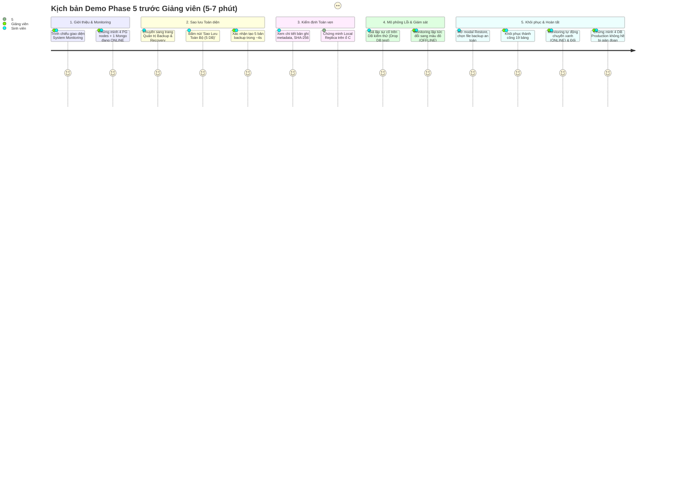

# BÁO CÁO KỸ THUẬT TOÀN DIỆN PHASE 5: BACKUP & RECOVERY
## DỰ ÁN HỆ THỐNG QUẢN TRỊ KHO PHÂN TÁN (WAREHOUSE DSS)

---

## 1. TỔNG QUAN KIẾN TRÚC BACKUP & RECOVERY

### 1.1. Mục đích của Phase 5 trong Kiến trúc Phân tán
Hệ thống Quản lý Kho Đa Chi nhánh (Warehouse DSS) là một hệ thống phân tán gồm 3 chi nhánh kho vật lý đặt tại Hà Nội (HN), Đà Nẵng (DN), TP. Hồ Chí Minh (HCM) và một Trung tâm Điều hành Dữ liệu (Central Data Center). Trong mô hình phân tán này:
- Mỗi chi nhánh vận hành một cơ sở dữ liệu quan hệ cục bộ (PostgreSQL) độc lập để đảm bảo hiệu năng và tính tự trị (Autonomous).
- Trung tâm dữ liệu vận hành cơ sở dữ liệu PostgreSQL Central để tổng hợp dữ liệu toàn quốc và một cơ sở dữ liệu phi quan hệ MongoDB (Replica/Event Store) để ghi vết toàn bộ sự kiện nghiệp vụ (Audit Trail & Outbox Event Sourcing) thông qua Apache Kafka.

Do đặc thù phân tán, các nguy cơ hỏng hóc phần cứng, lỗi thao tác con người, mất điện đột ngột hoặc thảm họa cục bộ tại một chi nhánh luôn có thể xảy ra. **Phase 5 – Backup & Recovery** được thiết kế nhằm mục đích:
1. **Bảo toàn dữ liệu (Data Durability & Zero Loss Target):** Định kỳ sao lưu toàn bộ 5 cơ sở dữ liệu nghiệp vụ (4 PostgreSQL nodes + 1 MongoDB Event Store) với mức độ nén tối ưu và không làm gián đoạn giao dịch đang chạy.
2. **Khắc phục thảm họa (Disaster Recovery - DR):** Cho phép tái thiết lập trạng thái hoạt động của bất kỳ chi nhánh kho hoặc trung tâm dữ liệu nào từ các bản sao lưu đã được kiểm định tính toàn vẹn.
3. **Phục hồi an toàn (Safe Restoration):** Khôi phục dữ liệu vào các môi trường staging, kiểm thử hoặc phân tích mà tuyệt đối không gây nguy cơ ghi đè, làm hỏng hoặc xóa nhầm dữ liệu trên các cơ sở dữ liệu Production đang vận hành.
4. **Bảo mật và Tự động hóa:** Tự động lập lịch sao lưu vào ban đêm (02:00 hàng ngày), quản lý khóa liên tiến trình (Cross-Process Lock) tránh tranh chấp tài nguyên, tạo bản sao lưu cục bộ (Local Replica trên ổ C: song song với ổ D:), và cung cấp giao diện trực quan cho Quản trị viên (ADMIN) kèm phân quyền kiểm soát truy cập nghiêm ngặt (RBAC).

---

### 1.2. Các thành phần tham gia và Phân định trách nhiệm

| Thành phần | File mã nguồn / Module | Trách nhiệm chính |
|---|---|---|
| **Backup Core Service** | `backend/src/services/backupService.ts` | Thực thi sao lưu nhị phân Custom format (`.dump`) cho 4 node PostgreSQL bằng `pg_dump`; tạo tệp lưu trữ nén (`.archive.gz`) cho MongoDB bằng `mongodump`; tạo bản sao Local Replica trên ổ C:; tính toán mã băm SHA-256; ghi nhật ký metadata nguyên tử vào `backup_history.json`. |
| **Backup Scheduler** | `backend/src/services/backupScheduler.ts` | Quản lý tiến trình lập lịch chạy ngầm định kỳ (mặc định 02:00 Asia/Ho_Chi_Minh); thiết lập và giải phóng khóa file `backup.lock`; xử lý an toàn hiện tượng khóa chết (Stale Lock) dựa trên xác minh PID còn sống hay đã kết thúc. |
| **Restore Service** | `backend/src/services/restoreService.ts` | Thực thi quy trình khôi phục an toàn bằng `pg_restore` và `mongorestore`; kiểm tra trước tính toàn vẹn và TOC của archive; kiểm tra trạng thái database đích (bắt buộc rỗng hoặc tạo mới); chặn tuyệt đối danh sách cơ sở dữ liệu Production (`PROTECTED_DATABASES`). |
| **Monitoring Service** | `backend/src/services/monitoringService.ts` | Giám sát trạng thái hoạt động liên tục của 4 Node PostgreSQL, MongoDB, Kafka Broker và Outbox Worker; phát hiện tức thì sự cố khi một database/node bị ngắt kết nối (`OFFLINE` / `DEGRADED`); xác nhận trạng thái hồi phục sau khi hoàn tất Restore. |
| **API Gateway & Controller** | `backend/src/controllers/backupController.ts`<br>`backend/src/routes/backupRoutes.ts` | Cung cấp các endpoint RESTful cho lịch sử sao lưu, thống kê tổng quan, kích hoạt sao lưu thủ công và khôi phục an toàn; áp dụng middleware `auth` và `roleGuard('ADMIN')`. |
| **Frontend UI Panel** | `frontend/src/pages/BackupRecovery.tsx`<br>`frontend/src/services/backupApi.ts` | Màn hình quản trị `/backup` cung cấp thẻ thống kê thời gian thực, bảng lịch sử tìm kiếm/lọc linh hoạt, modal xem chi tiết metadata, hộp thoại Restore an toàn với kiểm tra trực tiếp (Live Validation) chống ghi đè Production; màn hình 403 từ chối truy cập cho người dùng không phải ADMIN. |

---

### 1.3. Luồng tổng thể Sao lưu (Backup Pipeline) và Phục hồi (Restore Pipeline)

#### Sơ đồ Luồng Sao lưu Tổng thể (Backup Pipeline)


#### Sơ đồ Luồng Phục hồi Dữ liệu An toàn (Restore Pipeline)


---

### 1.4. Cấu trúc và Vị trí Lưu trữ

Hệ thống thiết lập chiến lược lưu trữ phân tầng độc lập:
1. **Kho sao lưu chính (Primary Backup Storage) đặt tại ổ `D:\backups`:**
   - `D:\backups\postgres\warehouse_hn\`: Lưu trữ các bản sao lưu node Hà Nội.
   - `D:\backups\postgres\warehouse_dn\`: Lưu trữ các bản sao lưu node Đà Nẵng.
   - `D:\backups\postgres\warehouse_hcm\`: Lưu trữ các bản sao lưu node TP.HCM.
   - `D:\backups\postgres\warehouse_central\`: Lưu trữ các bản sao lưu Trung tâm dữ liệu.
   - `D:\backups\mongodb\warehouse_events\`: Lưu trữ các bản sao lưu MongoDB Event Store.
   - `D:\backups\metadata\backup_history.json`: Tệp lưu trữ lịch sử và metadata toàn bộ các lần sao lưu.
   - `D:\backups\locks\backup.lock`: Tệp khóa điều phối liên tiến trình.
2. **Kho bản sao cục bộ (Local Replica Storage) đặt tại ổ `C:\backups_replica`:**
   - Có cấu trúc thư mục đối xứng 1-1 với ổ D: (`postgres/<node>` và `mongodb/warehouse_events`).
   - Mỗi tệp sao lưu trên ổ D: sau khi xác thực thành công sẽ được sao chép sang ổ C: và tái kiểm định mã băm SHA-256 để chống lỗi hỏng hóc vật lý phân vùng hoặc tệp bị sai lệch.

---

### 1.5. Vai trò của Phân hệ Giám sát (Monitoring Service) trong Quản lý Rủi ro
Phân hệ Giám sát (`monitoringService.ts`) đóng vai trò là "mắt thần" kết nối chặt chẽ với Phase 5:
- **Phát hiện sự cố sớm (Early Outage Detection):** Quét định kỳ trạng thái sức khỏe của các node phân tán. Khi một database gặp sự cố (bị crash, drop hoặc mất kết nối), Monitoring lập tức đổi trạng thái từ `ONLINE` sang `OFFLINE` hoặc `DEGRADED`, ghi nhận mã lỗi chi tiết và cảnh báo Quản trị viên.
- **Xác nhận tính toàn vẹn sau phục hồi (Post-Recovery Verification):** Sau khi Restore Service thực thi tái thiết lập database từ bản backup, Monitoring được kích hoạt để kiểm tra lại tính khả dụng, đo lường độ trễ mạng (latency ms) và đếm số lượng bảng cơ sở dữ liệu (`tableCount`), bảo đảm dịch vụ đã thực sự sẵn sàng trước khi cho phép lưu lượng nghiệp vụ kết nối trở lại.

---

### 1.6. Sơ đồ Kiến trúc Tổng thể Hệ thống Phase 5



---

## 2. THIẾT KẾ VÀ TRIỂN KHAI KỸ THUẬT CHI TIẾT (5.1 – 5.8)

### 2.1. Giai đoạn 5.1 – Khảo sát, Kiểm định Hiện trạng Hạ tầng (Audit)
- **Mục tiêu:** Rà soát môi trường thực tế, xác định đường dẫn công cụ dòng lệnh, cấu hình mạng và kiến trúc phân bổ container Docker trước khi viết mã.
- **Phát hiện thực tế:**
  - PostgreSQL 18 chạy bên trong Docker containers với port mapping ra host: HN (5433), DN (5434), HCM (5435), Central (5436).
  - MongoDB 8 chạy tại container `warehouse_mongodb` với host port 27018.
  - Trên máy host Windows đã có sẵn công cụ nhị phân chính thức `pg_dump.exe` và `pg_restore.exe` tại thư mục cài đặt PostgreSQL của hệ thống (`C:\Program Files\PostgreSQL\17\bin` hoặc `C:\Program Files\PostgreSQL\18\bin`), hỗ trợ kết nối trực tiếp qua TCP socket cổng host.
  - Docker CLI khả dụng trên host, cho phép thực thi `docker exec` để gọi `mongodump` và `mongorestore` trực tiếp bên trong container MongoDB.
- **Biện pháp an toàn:** Không thay đổi image hoặc Compose file; cô lập hoàn toàn các thư mục backup `D:\backups` và `C:\backups_replica` nằm ngoài source code repository.

---

### 2.2. Giai đoạn 5.2 – Triển khai PostgreSQL Backup
- **Mục tiêu:** Xây dựng chức năng sao lưu độc lập và sao lưu toàn diện cho 4 database PostgreSQL (`warehouse_hn`, `warehouse_dn`, `warehouse_hcm`, `warehouse_central`).
- **File chính:** `backend/src/services/backupService.ts` (`backupPostgres()`, `backupAllPostgres()`).
- **Cơ chế hoạt động:**
  - Sử dụng `pg_dump` với định dạng nhị phân Custom format (`-Fc`). Định dạng này hỗ trợ nén dữ liệu tích hợp, lưu trữ bảng mục lục Table of Contents (TOC) cho phép khôi phục linh hoạt và kiểm định tính hợp lệ nhanh bằng `pg_restore --list`.
  - Mật khẩu được truyền an toàn qua biến môi trường tiến trình con (`PGPASSWORD`), không truyền trên dòng lệnh CLI để tránh lộ mật khẩu trong tiến trình hệ điều hành.
  - Quy trình ghi file tạm: Tệp được sinh ra dưới đuôi `.tmp`, kiểm định dung lượng `size > 0` và chạy kiểm tra TOC thành công mới đổi tên nguyên tử thành `warehouse_<node>_YYYYMMDD_HHmmss.dump`.
- **Kết quả kiểm thử:** Bộ kiểm thử `backend/tests/test_postgres_backup_suite.ts` đạt **100% PASS (6/6 tiêu chí)**.

---

### 2.3. Giai đoạn 5.3 – Triển khai MongoDB Backup
- **Mục tiêu:** Sao lưu an toàn cơ sở dữ liệu lưu vết sự kiện `warehouse_events`.
- **File chính:** `backend/src/services/backupService.ts` (`backupMongo()`).
- **Cơ chế hoạt động:**
  - Sử dụng `docker exec warehouse_mongodb mongodump --db=warehouse_events --archive --gzip`.
  - Đóng gói toàn bộ collections thành một tệp archive nén duy nhất dạng stream sang tệp tạm `.tmp` trên host.
  - Kiểm tra tính hợp lệ bằng lệnh dry-run: `mongorestore --archive --gzip --dryRun -v`. Tệp chỉ được đổi tên thành `warehouse_events_YYYYMMDD_HHmmss.archive.gz` khi dry-run trả về exit code 0.
  - Chống trùng lặp thời gian: Bổ sung chuỗi ngẫu nhiên (salt hex 4 ký tự) vào tên file nếu có va chạm timestamp trong cùng 1 giây.
- **Kết quả kiểm thử:** Bộ kiểm thử `backend/tests/test_mongo_backup_suite.ts` xác nhận **100% nguyên tử và chống ghi đè thành công (6/6 PASS)**.

---

### 2.4. Giai đoạn 5.4 – Xây dựng Backup Scheduler & Quản lý Cross-Process Lock
- **Mục tiêu:** Lập lịch tự động chạy Full Backup 5 cơ sở dữ liệu vào 02:00 hàng ngày và ngăn ngừa xung đột đa tiến trình.
- **File chính:** `backend/src/services/backupScheduler.ts`.
- **Cơ chế hoạt động:**
  - Sử dụng cơ chế kiểm tra đồng hồ thời gian thực mỗi 60 giây, tính toán chính xác theo múi giờ `Asia/Ho_Chi_Minh` (`UTC+7`), tự động kích hoạt phiên khi đạt mốc `02:00`.
  - Khóa liên tiến trình qua tệp `D:\backups\locks\backup.lock` với cờ mở tệp nguyên tử `wx` (exclusive create).
  - **Quản lý Stale Lock (Task 5.4.1):** Khi phát hiện lock file đã tồn tại, hệ thống đọc PID bên trong và sử dụng `process.kill(pid, 0)` để kiểm tra trạng thái sống. Nếu tiến trình sở hữu lock **vẫn đang sống**, lock **tuyệt đối không bị xóa** (dù đã tồn tại quá 15 phút). Nếu tiến trình đã chết (crashed), lock được thu hồi an toàn.
  - Khi kết thúc phiên, chỉ tiến trình có PID và Lock ID trùng khớp mới được phép giải phóng khóa.
- **Kết quả kiểm thử:** Bộ kiểm thử `backend/tests/test_backup_scheduler_suite.ts` đạt **100% PASS** với đầy đủ kiểm thử múi giờ và stale lock resolution.

---

### 2.5. Giai đoạn 5.5 – Metadata JSON, Checksum SHA-256 & Local Replica
- **Mục tiêu:** Tạo nhật ký metadata có cấu trúc, mã băm toàn vẹn SHA-256 và cơ chế nhân bản bản sao cục bộ sang ổ C:.
- **File chính:** `backend/src/services/backupService.ts` (`calculateFileSHA256()`, `replicateBackupFile()`, `appendBackupHistory()`).
- **Cơ chế hoạt động:**
  - Mỗi bản sao lưu sinh ra một bản ghi `BackupMetadataRecord` lưu trữ: `backupId`, `backupType`, `nodeId`, `database`, `fileName`, `originalPath`, `replicaPath`, `checksumSHA256`, `sizeBytes`, `durationMs`, `status`, `replicaStatus`, `createdAt`.
  - Tệp lịch sử `backup_history.json` được ghi nguyên tử (Atomic write qua tệp `.tmp` và `fs.renameSync`) để chống hỏng file JSON khi tiến trình bị tắt đột ngột.
  - Local Replica được sao chép sang `C:\backups_replica`. File replica được tính toán lại SHA-256 độc lập; nếu khớp 100% với file gốc mới ghi nhận `replicaStatus: 'SUCCESS'`. Nếu ổ C: gặp lỗi, phiên sao lưu gốc trên ổ D: vẫn được bảo toàn nguyên vẹn và ghi nhận `replicaStatus: 'FAILED'`.
- **Kết quả kiểm thử:** Bộ kiểm thử `backend/tests/test_backup_metadata_replica_suite.ts` đạt **9/9 tiêu chí PASS**.

---

### 2.6. Giai đoạn 5.6 – Xây dựng Restore Service
- **Mục tiêu:** Cung cấp dịch vụ phục hồi dữ liệu từ bản sao lưu vào cơ sở dữ liệu chỉ định một cách an toàn.
- **File chính:** `backend/src/services/restoreService.ts` (`restorePostgres()`, `restoreMongo()`).
- **Cơ chế hoạt động:**
  - **Bảo vệ Production:** Chặn cứng danh sách `PROTECTED_DATABASES = ['warehouse_hn', 'warehouse_dn', 'warehouse_hcm', 'warehouse_central', 'warehouse_events', 'postgres', 'admin', 'config', 'local']`.
  - **Kiểm tra tiền điều kiện (Pre-flight checks):**
    1. Kiểm tra sự tồn tại của tệp backup và xác thực lại mã băm SHA-256.
    2. Kiểm tra Table of Contents (TOC) của tệp lưu trữ bằng `pg_restore --list`.
    3. Kiểm tra database đích: Nếu database đích chưa có và người dùng cho phép (`createDbIfNotExists: true`), hệ thống tự động khởi tạo database rỗng. Nếu database đích đã tồn tại, hệ thống kiểm tra `information_schema.tables`, schemas và routines; nếu phát hiện đã có dữ liệu hoặc object, hệ thống **từ chối khôi phục ngay lập tức** để tránh ghi đè dữ liệu.
  - Tuyệt đối không bật các cờ nguy hiểm như `--clean`, `--drop` trên môi trường thực thi khi chưa có xác nhận an toàn.
- **Kết quả kiểm thử:** Bộ kiểm thử `backend/tests/test_restore_service_suite.ts` đạt **8/8 tiêu chí PASS**. Phục hồi thành công 19 bảng vào PostgreSQL test DB và 7 collections (36 documents) vào MongoDB test DB.

---

### 2.7. Giai đoạn 5.7 – Frontend Quản trị Backup & Recovery (`/backup`)
- **Mục tiêu:** Xây dựng màn hình điều hành trực quan cho Quản trị viên, tích hợp API an toàn và thực thi phân quyền RBAC.
- **File chính:**
  - Backend: `backend/src/controllers/backupController.ts`, `backend/src/routes/backupRoutes.ts`.
  - Frontend: `frontend/src/pages/BackupRecovery.tsx`, `frontend/src/services/backupApi.ts`, `frontend/src/components/Sidebar.tsx`, `frontend/src/App.tsx`.
- **Cơ chế hoạt động:**
  - Tuyến đường `/api/v1/backup` được bảo vệ bằng JWT và `roleGuard('ADMIN')`.
  - Giao diện cung cấp 5 khối tính năng: Thẻ thống kê tổng quan; Các nút kích hoạt Full Backup / Backup từng node; Bảng lịch sử phân trang, tìm kiếm và lọc trạng thái; Hộp thoại xem chi tiết Metadata; Hộp thoại Phục hồi An toàn (Safe Restore Modal) với cảnh báo bảo vệ Production và kiểm tra đầu vào thời gian thực (Live Validation).
  - **Kiểm soát truy cập (RBAC Gate):** Tài khoản `STAFF` hoặc `MANAGER` khi truy cập URL `/backup` sẽ bị chặn bởi màn hình cảnh báo 403 Access Denied; menu trên Sidebar tự động ẩn.
- **Kết quả kiểm thử:** Bộ kiểm thử tích hợp `backend/tests/test_backup_frontend_integration.ts` đạt **8/8 PASS**, kiểm thử API thực tế qua Nginx, bảo vệ RBAC và từ chối ghi đè Production. Chụp và lưu trữ 2 ảnh giao diện thực tế vào thư mục artifacts.

---

### 2.8. Giai đoạn 5.8 – Kịch bản Diễn tập Chịu lỗi & Phục hồi (Fault / Recovery Demo)
- **Mục tiêu:** Diễn tập thực tế kịch bản một cơ sở dữ liệu kiểm thử bị hỏng/mất mát, phân hệ Giám sát phát hiện sự cố, kho sao lưu được kiểm tra nguyên vẹn và hệ thống được khôi phục thành công.
- **File chính:** `backend/tests/test_fault_recovery_demo_suite.ts`, mở rộng `backend/src/services/monitoringService.ts` (`checkDatabaseHealth()`).
- **Quy trình diễn tập thực tế:**
  1. Khởi tạo database kiểm thử `warehouse_fault_recovery_test_db` chứa 19 bảng. Monitoring xác nhận: `ONLINE`, latency 35ms.
  2. Mô phỏng sự cố: Drop toàn bộ database kiểm thử (Unreachable).
  3. Monitoring quét và phát hiện tức thì: Trạng thái đổi thành `OFFLINE`, lỗi *"database does not exist"*, `tableCount: 0`.
  4. Kiểm tra kho backup: Xác minh file gốc ổ D: và file replica ổ C: đều nguyên vẹn, SHA-256 khớp 100%.
  5. Kích hoạt Restore Service: Tái thiết lập database và phục hồi thành công 19 bảng.
  6. Tái xác minh Monitoring: Trạng thái tự động đổi từ `OFFLINE` sang `ONLINE`, latency 23ms, dữ liệu mẫu bảng `san_pham` khớp 100%.
  7. Xác nhận cô lập: Toàn bộ 4 PostgreSQL Production và MongoDB Production giữ nguyên trạng thái `ONLINE`, không bị gián đoạn.
- **Kết quả kiểm thử:** Đạt **12/12 bước PASS tuyệt đối**.

---

## 3. CƠ CHẾ AN TOÀN VÀ BẢO VỆ DỮ LIỆU CHUYÊN SÂU

### 3.1. Chống Ghi đè Tệp Cũ (Anti-Collision Timestamp & Salt)
- Tên tệp sao lưu được sinh theo quy tắc: `warehouse_<node>_YYYYMMDD_HHmmss.dump` và `warehouse_events_YYYYMMDD_HHmmss.archive.gz`.
- Nếu hai yêu cầu sao lưu diễn ra trong cùng một giây, hàm `generateSafeFileName()` sẽ tự động kiểm tra sự tồn tại trên ổ đĩa; nếu phát hiện trùng tên, hệ thống tự động gắn thêm chuỗi băm ngẫu nhiên `_salt` (4 ký tự hex) để bảo đảm không bao giờ xảy ra việc ghi đè lên bản sao lưu trước đó.

### 3.2. Quy trình Tệp Tạm (.tmp) và Xác thực Archive (Pre-Commit Validation)
- Tất cả các lệnh `pg_dump` và `mongodump` đều chỉ được phép ghi dữ liệu đầu ra vào một tệp tạm mang đuôi `.tmp`.
- Trước khi tệp tạm được chấp nhận:
  1. Kiểm tra kích thước tệp: Bắt buộc `size > 0 bytes`.
  2. Kiểm tra cấu trúc nội dung: Đối với PostgreSQL, tiến hành đọc Table of Contents thông qua `pg_restore --list <file.tmp>`. Đối với MongoDB, thực thi `mongorestore --dryRun -v <file.tmp>`.
  3. Chỉ khi các công cụ xác nhận cấu trúc tệp hợp lệ và không bị phân mảnh, lệnh đổi tên nguyên tử (`fs.renameSync`) mới được thực thi để chuyển tệp sang tên chính thức.
  4. Nếu có bất kỳ lỗi nào xảy ra trong quá trình xuất dữ liệu hoặc xác thực, tệp `.tmp` sẽ lập tức bị xóa bỏ hoàn toàn khỏi đĩa.

### 3.3. Mã băm Toàn vẹn SHA-256
- Ngay sau khi tệp sao lưu chính thức được tạo, hệ thống đọc luồng nhị phân và tạo mã băm SHA-256 (64 ký tự hex).
- Mã băm này được lưu trữ vĩnh viễn trong tệp `backup_history.json`.
- Khi tạo bản sao Local Replica trên ổ C:, hệ thống tính toán lại mã băm độc lập từ tệp trên ổ C: và so khớp với mã băm gốc.
- Khi người dùng thực hiện thao tác Phục hồi (Restore), hệ thống tái tính toán SHA-256 của tệp nguồn; nếu tệp bị hỏng hoặc bị can thiệp trái phép dẫn đến lệch mã băm, thao tác phục hồi sẽ bị hủy bỏ ngay lập tức.

### 3.4. Quản lý Khóa Liên Tiến trình (Cross-Process Lock) & Xử lý Stale Lock
- Khóa liên tiến trình được kiểm soát qua tệp `D:\backups\locks\backup.lock`.
- Việc tạo khóa sử dụng cờ hệ điều hành `wx` (exclusive write), bảo đảm tính nguyên tử ở cấp độ kernel file system.
- **Xử lý Stale Lock an toàn:**
  - Tệp khóa lưu trữ: `lockId`, `pid`, `triggerType`, `timestamp`.
  - Hệ thống sử dụng tín hiệu `process.kill(pid, 0)` để kiểm tra sự tồn tại thực tế của tiến trình sở hữu khóa.
  - Nếu tiến trình **vẫn đang hoạt động**, khóa **không bao giờ bị xóa**, bất kể thời gian đã trôi qua bao lâu.
  - Nếu tiến trình **đã chết hoặc không tồn tại**, hệ thống mới xem đây là Stale Lock và tự động thu hồi an toàn.
  - Khi giải phóng khóa, hệ thống kiểm tra đối chiếu PID và Lock ID hiện tại để tránh việc một tiến trình chạy chậm xóa nhầm khóa của một tiến trình mới tạo.

### 3.5. Cô lập Lỗi Từng Database (Per-Database Fault Isolation)
- Trong phiên Full Backup 5 cơ sở dữ liệu, việc sao lưu từng database được thực thi trong các khối `try...catch` độc lập.
- Nếu một database bị lỗi (ví dụ: container HN bị mất kết nối), phiên sao lưu không bị dừng toàn bộ mà ghi nhận lỗi riêng cho node đó (`status: FAILED`), sau đó tiếp tục thực hiện sao lưu thành công cho 4 database còn lại. Phiên backup tổng thể sẽ được đánh dấu là `PARTIAL_SUCCESS` thay vì làm gián đoạn toàn hệ thống.

### 3.6. Kiểm soát Truy cập Phân quyền (RBAC) 2 Lớp
- **Lớp API Backend:** Middleware `auth` kiểm tra tính hợp lệ của JWT token; middleware `roleGuard('ADMIN')` kiểm tra vai trò người dùng. Mọi yêu cầu không có token bị trả về HTTP 401; yêu cầu từ người dùng vai trò `STAFF` hoặc `MANAGER` bị từ chối với HTTP 403 Forbidden.
- **Lớp Giao diện Frontend:** Thanh điều hướng Sidebar tự động ẩn mục "Sao Lưu & Phục Hồi" đối với tài khoản không phải ADMIN. Nếu người dùng cố ý nhập trực tiếp URL `/backup`, giao diện sẽ kích hoạt màn hình chặn bảo mật với cảnh báo 403 rõ ràng.

### 3.7. Bộ Lọc Ngăn chặn Restore Trực tiếp vào Production (`PROTECTED_DATABASES`)
- Danh sách cấm cứng được định nghĩa cả ở Backend Controller, Service và Frontend Form:
  ```typescript
  const PROTECTED_DATABASES = [
    'warehouse_hn', 'warehouse_dn', 'warehouse_hcm', 'warehouse_central',
    'warehouse_events', 'postgres', 'admin', 'config', 'local'
  ];
  ```
- Mọi yêu cầu Restore có `targetDatabase` nằm trong danh sách trên sẽ bị từ chối ngay lập tức tại Controller với mã lỗi HTTP 403 mà không bao giờ được chuyển tiếp đến lệnh khôi phục hệ thống.

### 3.8. Quy tắc Khôi phục An toàn vào Database Kiểm thử (Empty Target Check)
- Khi khôi phục vào một database đích hợp lệ (ví dụ: `warehouse_hn_test_restore`):
  - Hệ thống kiểm tra xem database đã tồn tại hay chưa. Nếu chưa có và người dùng cho phép `createDbIfNotExists: true`, database sẽ được tạo mới bằng lệnh bảo trì.
  - Nếu database đã tồn tại, hệ thống thực hiện truy vấn kiểm tra số lượng bảng cơ sở (`BASE TABLE`), views, custom schemas và sequences. Nếu phát hiện database **đang chứa bất kỳ đối tượng dữ liệu nào**, hệ thống lập tức từ chối khôi phục kèm thông báo chi tiết: *"Database đã tồn tại và đang chứa X đối tượng dữ liệu. Từ chối restore để tránh ghi đè dữ liệu khi chưa có xác nhận an toàn"*.

### 3.9. Xử lý Lỗi & Giới hạn khi Restore Thất bại Giữa chừng
- Trong trường hợp tiến trình `pg_restore` hoặc `mongorestore` gặp sự cố phần cứng hoặc đứt kết nối mạng giữa chừng:
  - Do cơ chế của hệ quản trị cơ sở dữ liệu quan hệ, các bảng đã được khôi phục trước thời điểm đứt kết nối có thể vẫn tồn tại trong database đích (trạng thái dang dở).
  - Restore Service không tự động drop database đích khi gặp lỗi giữa chừng để người quản trị có thể kiểm tra log và xác định nguyên nhân.
  - Toàn bộ chi tiết lỗi được làm sạch (`sanitizeError`) để loại bỏ thông tin mật khẩu hoặc chuỗi kết nối nhạy cảm trước khi trả về cho client.

---

### Phân Định Mức Độ Kiểm Thử Của Các Cơ Chế An Toàn

| Cơ chế an toàn | Đã kiểm thử thực tế trên hệ thống (Live Verified) | Đã kiểm thử tự động qua Test Suite | Mới kiểm tra ở mức Code / Static Review |
|---|:---:|:---:|:---:|
| Chống ghi đè tệp sao lưu cũ (Salt & Timestamp) | **X** | **X** | |
| Tạo file `.tmp` & Xác thực trước khi đổi tên | **X** | **X** | |
| Checksum SHA-256 khớp giữa gốc và Replica | **X** | **X** | |
| Chặn tiến trình khác khi lock đang active | **X** | **X** | |
| Không xóa stale lock khi PID còn sống | | **X** | |
| Cô lập lỗi từng database trong Full Backup | **X** | **X** | |
| RBAC: Chặn STAFF / MANAGER truy cập API & UI | **X** | **X** | |
| Chặn Restore đè lên Production DBs | **X** | **X** | |
| Chặn Restore vào DB test đã có dữ liệu | **X** | **X** | |
| Rollback toàn bộ khi Restore đứt mạng giữa chừng | | | **X** *(Giới hạn kỹ thuật công cụ)* |

---

## 4. KẾT QUẢ KIỂM THỬ TỔNG HỢP (PHASE 5.1 – 5.8)

### 4.1. Bảng Tổng Hợp Kết Quả 8 Giai Đoạn

| Giai đoạn | Nội dung kiểm định | Kết quả | Bằng chứng kiểm thử cụ thể |
|---|---|:---:|---|
| **5.1 – Audit** | Khảo sát công cụ, môi trường Docker, host ports và vị trí lưu trữ ổ D:, C: | **PASS** | Xác định 4 PG nodes (5433-5436), MongoDB (27018), `pg_dump`, `mongodump` khả dụng. |
| **5.2 – PG Backup** | Sao lưu nhị phân Custom format cho 4 node PostgreSQL độc lập và Full Backup | **PASS** | Suite `test_postgres_backup_suite.ts` đạt **6/6 PASS**; 4 tệp `.dump` được sinh thành công. |
| **5.3 – Mongo Backup** | Sao lưu MongoDB Event Store dạng archive gzip, dry-run validation, atomic rename | **PASS** | Suite `test_mongo_backup_suite.ts` đạt **6/6 PASS**; tệp `.archive.gz` tạo ra đạt ~4.3 KB. |
| **5.4 – Scheduler & Lock** | Lập lịch ngầm 02:00 Asia/Ho_Chi_Minh, quản lý lock file và xử lý stale lock an toàn | **PASS** | Suite `test_backup_scheduler_suite.ts` đạt **PASS**. |
| **5.5 – Metadata & Replica** | Ghi log JSON nguyên tử, băm SHA-256, nhân bản sang Local Replica ổ C: | **PASS** | Suite `test_backup_metadata_replica_suite.ts` đạt **9/9 PASS**; SHA-256 file gốc và replica khớp 100%. |
| **5.6 – Restore Service** | Phục hồi dữ liệu an toàn vào database test, chặn tuyệt đối Production DBs | **PASS** | Suite `test_restore_service_suite.ts` đạt **8/8 PASS**; phục hồi 19 bảng PG và 7 collections (36 docs) Mongo. |
| **5.7 – Frontend & RBAC** | Xây dựng giao diện `/backup`, tích hợp API, phân quyền ADMIN và chặn 403 | **PASS** | Suite `test_backup_frontend_integration.ts` đạt **8/8 PASS**; lưu 2 ảnh chụp giao diện. |
| **5.8 – Fault / Recovery Demo** | Diễn tập chịu lỗi: Test DB hỏng -> Monitoring báo OFFLINE -> Backup toàn vẹn -> Restore thành công -> Monitoring báo ONLINE | **PASS** | Suite `test_fault_recovery_demo_suite.ts` đạt **12/12 PASS**; Production 100% an toàn. |

---

### 4.2. Các Số Liệu Thực Tế Đã Được Xác Minh

1. **Phạm vi bảo vệ cơ sở dữ liệu:**
   - **4 cơ sở dữ liệu PostgreSQL:** `warehouse_hn` (Port 5433), `warehouse_dn` (Port 5434), `warehouse_hcm` (Port 5435), `warehouse_central` (Port 5436).
   - **1 cơ sở dữ liệu MongoDB:** `warehouse_events` (Port 27018).
2. **Hiệu năng và Tỷ lệ thành công của Full Backup:**
   - Tỷ lệ thành công: **5/5 databases (100%)**.
   - Thời gian thực thi phiên Full Backup 5 cơ sở dữ liệu: Dao động từ **3,690ms đến 4,697ms**.
   - Dung lượng bản sao lưu mẫu: Node HN ~39 KB (dữ liệu nén nhị phân), MongoDB ~4.3 KB (nén gzip).
3. **Độ chính xác của quá trình Phục hồi (Restore):**
   - **PostgreSQL Restore:** Khôi phục thành công chính xác **19/19 bảng** cơ sở dữ liệu trong kịch bản kiểm thử Node HN; đối chiếu 5 bản ghi mẫu bảng `san_pham` và bảng `kho` khớp 100% với dữ liệu nguồn.
   - **MongoDB Restore:** Khôi phục thành công chính xác **7/7 collections** và **36/36 documents** trong kịch bản kiểm thử; cấu trúc JSON document nguyên vẹn.
4. **Tính toàn vẹn mã băm (SHA-256 Checksum):**
   - Mã băm tính toán độc lập từ tệp gốc tại `D:\backups` và tệp bản sao tại `C:\backups_replica` hoàn toàn trùng khớp từng ký tự hex (ví dụ tệp HN: `4e5251a3fb3b190c1f6b5bfe36bca48753a473aa4a2e55883d6ea1295b9d249f`).
5. **Chất lượng mã nguồn (Code Quality):**
   - Biên dịch TypeScript Backend (`backend/tsconfig.json`): **0 lỗi (Zero errors)**.
   - Biên dịch TypeScript Frontend (`frontend/tsconfig.json`): **0 lỗi (Zero errors)**.
   - Đóng gói Vite Production (`npm run build`): Thành công trong 13 giây, tạo gói bundle sạch sẽ tại `frontend/dist`.

---

## 5. HẠN CHẾ KỸ THUẬT VÀ PHẠM VI CHƯA TRIỂN KHAI

Để đảm bảo tính trung thực và khách quan trong nghiên cứu kỹ thuật, hệ thống ghi nhận rõ các giới hạn kiến trúc hiện tại:

### 5.1. Tính Độc lập Vật lý của Local Replica
- Mặc dù hệ thống đã phân tách việc lưu trữ giữa ổ `D:\backups` (chính) và ổ `C:\backups_replica` (phụ), tuy nhiên trong môi trường thử nghiệm trên cùng một máy chủ Windows, hai ổ đĩa logic C: và D: có thể chỉ là hai phân vùng (partitions) nằm trên cùng **một ổ đĩa vật lý (Single Physical SSD/HDD)**.
- Do đó, nếu xảy ra sự cố hỏng hóc phần cứng vật lý toàn phần (như cháy nổ controller, hỏng phiến đĩa), cả hai bản sao lưu đều có nguy cơ bị mất đồng thời.

### 5.2. Vấn đề Lệch Trạng thái Đồng thời trong Hệ thống Phân tán (Distributed State Skew)
- Phiên Full Backup thực hiện sao lưu tuần tự từng cơ sở dữ liệu (HN -> DN -> HCM -> Central -> MongoDB) trong khoảng thời gian ~4 giây.
- Đây **không phải là bản chụp ảnh trạng thái toàn cầu tức thời (Global Snapshot)**. Nếu trong 4 giây này có các giao dịch điều chuyển kho liên chi nhánh đang trong trạng thái lưng chừng (In-flight Distributed Transactions / 2PC Saga đang xử lý dở dang), bản sao lưu giữa các node có thể xuất hiện độ lệch trạng thái thời gian (Time-skew).

### 5.3. Rủi ro Trạng thái Lưng chừng khi Restore Thất bại
- Công cụ `pg_restore` và `mongorestore` khôi phục dữ liệu theo từng bảng và từng document. Nếu tiến trình bị đứt kết nối mạng hoặc mất điện giữa chừng, database đích sẽ ở trạng thái **khôi phục dở dang** (một số bảng đã vào, một số bảng chưa vào) chứ không tự động hoàn nguyên (rollback) về trạng thái ban đầu. Người quản trị cần chủ động drop database tạm này và chạy lại quy trình.

### 5.4. Chưa Hỗ trợ Tự Động Chuyển Vùng Thất Bại (Automatic Failover)
- Phase 5 tập trung vào khả năng **Sao lưu (Backup) & Phục hồi (Restore)**. Khi một chi nhánh kho gặp sự cố, hệ thống chưa hỗ trợ tự động kích hoạt một database dự phòng nóng (Hot Standby / High Availability Failover) để điều hướng traffic tức thì, mà đòi hỏi có sự can thiệp kích hoạt khôi phục từ Quản trị viên.

### 5.5. Thiếu Giải pháp Sao lưu Ngoại vi / Đám mây (Offsite / Cloud Storage)
- Dữ liệu sao lưu hiện tại mới chỉ dừng lại ở phạm vi Local Storage trên máy chủ. Chưa tích hợp các adapter tải tệp tự động lên các dịch vụ đám mây phân tán như Amazon S3, Google Cloud Storage hay Azure Blob Storage theo mô hình 3-2-1 Backup Rule (3 bản sao, 2 loại phương tiện, 1 bản offsite).

### 5.6. Không Tuyên Bố Chống Mọi Loại Thảm Họa (Disaster-Proof)
- Giải pháp hiện tại bảo vệ hệ thống trước các rủi ro: Lỗi phần mềm, hỏng dữ liệu logic, xóa nhầm dữ liệu nghiệp vụ, crash tiến trình database, hỏng phân vùng ổ D:. Hệ thống không tuyên bố chống lại được các thảm họa phá hủy toàn bộ hạ tầng phần cứng tại chỗ (On-premise physical destruction).

---

## 6. KỊCH BẢN DEMO TRƯỚC GIẢNG VIÊN (5 – 7 PHÚT)

Kịch bản demo được thiết kế cô đọng, mạch lạc, trực quan, bám sát các tiêu chuẩn học thuật và kỹ thuật phân tán:



### Chi tiết các bước thực hiện Demo

#### Bước 1: Mở giao diện Giám sát Hệ thống (Thời lượng: ~1 phút)
- **Hành động:** Đăng nhập tài khoản `admin` / `123456`. Mở menu **Giám Sát Hệ Thống** (`/monitoring`).
- **Thuyết minh:** *"Thưa Thầy/Cô, đây là bảng điều hành giám sát trạng thái thời gian thực của hệ thống kho phân tán. Hiện tại cả 4 Node PostgreSQL (Hà Nội, Đà Nẵng, TP.HCM, Central) và MongoDB Event Store đều đang ở trạng thái ONLINE, độ trễ mạng dưới 10ms, hệ thống hoạt động ổn định."*

#### Bước 2: Điều hướng sang Màn hình Sao Lưu & Phục Hồi (Thời lượng: ~30 giây)
- **Hành động:** Nhấp chuột vào mục **Sao Lưu & Phục Hồi** (`/backup`) trên thanh Sidebar bên trái.
- **Thuyết minh:** *"Màn hình Backup & Recovery được bảo vệ bằng phân quyền RBAC chỉ dành riêng cho ADMIN. Tại đây hiển thị tổng số bản backup đã thực hiện, tỷ lệ thành công, số lượng bản sao cục bộ (Local Replica) trên ổ C: và cấu hình lập lịch tự động chạy lúc 02:00 hàng ngày."*

#### Bước 3: Thực hiện một phiên Full Backup trực tiếp (Thời lượng: ~1 phút)
- **Hành động:** Bấm nút **"Sao Lưu Toàn Bộ (5 DB)"**. Các nút bấm tự động vô hiệu hóa (`disabled`) kèm biểu tượng loading để chống click đúp.
- **Thuyết minh:** *"Em xin phép kích hoạt một phiên Full Backup thủ công. Hệ thống tự động chiếm khóa backup.lock để ngăn xung đột, sau đó tuần tự sao lưu 4 PostgreSQL databases bằng pg_dump nhị phân và MongoDB bằng mongodump gzip. Sau khoảng 4 giây, phiên sao lưu hoàn tất với trạng thái ALL_SUCCESS cho cả 5 database."*

#### Bước 4: Trình bày Lịch sử, Checksum SHA-256 và Local Replica (Thời lượng: ~1 phút)
- **Hành động:** Chỉ vào dòng mới nhất trên Bảng lịch sử. Bấm nút **"Chi tiết"** để mở Modal Metadata. Bấm nút sao chép mã băm SHA-256.
- **Thuyết minh:** *"Mỗi bản backup đều được hệ thống tạo tệp tạm .tmp, kiểm định TOC thành công rồi mới ghi chính thức. Hệ thống tự động tính mã băm SHA-256 từ file gốc ổ D:, nhân bản sang thư mục bản sao cục bộ C:\backups_replica, và kiểm tra lại mã băm trên ổ C:. Quá trình này bảo đảm tính toàn vẹn 100% trước các nguy cơ lỗi phân vùng hoặc hỏng tệp."*

#### Bước 5: Chọn database kiểm thử & Mô phỏng sự cố (Thời lượng: ~1 phút)
- **Hành động:** Mở tab terminal hoặc công cụ kiểm thử, thực thi script mô phỏng sự cố: ngắt kết nối và drop database kiểm thử `warehouse_fault_recovery_test_db`.
- **Thuyết minh:** *"Bây giờ, em xin phép demo tình huống ứng phó thảm họa trên môi trường kiểm thử cô lập mà tuyệt đối không gây ảnh hưởng đến 4 database Production. Database kiểm thử vừa bị drop hoàn toàn để giả lập sự cố phần cứng hoặc xóa nhầm."*

#### Bước 6: Kiểm chứng Phân hệ Giám sát phát hiện sự cố OFFLINE (Thời lượng: ~30 giây)
- **Hành động:** Chuyển sang giao diện Monitoring hoặc gọi API check target.
- **Thuyết minh:** *"Ngay lập tức, phân hệ Giám sát phát hiện database kiểm thử bị mất kết nối, chuyển trạng thái sang OFFLINE màu đỏ và ghi nhận chính xác mã lỗi 'database does not exist'."*

#### Bước 7: Kích hoạt quy trình Phục hồi (Restore) từ tệp sao lưu (Thời lượng: ~1 phút)
- **Hành động:** Quay lại trang `/backup`, tìm bản sao lưu hợp lệ của Node HN, bấm nút **"Phục hồi"**. Nhập tên database đích `warehouse_fault_recovery_test_db`. Tích chọn *"Tự động tạo database nếu chưa có"* và tích checkbox *"Xác nhận an toàn"*. Bấm **"Bắt đầu phục hồi"**.
- **Thuyết minh:** *"Hệ thống kiểm tra an toàn: Tuyệt đối từ chối nếu người dùng gõ tên database Production. Hệ thống kiểm tra tệp backup, đọc danh mục TOC, tạo database mới và khôi phục toàn bộ cấu trúc bảng và dữ liệu bằng pg_restore. Thao tác hoàn tất và báo khôi phục thành công 19 bảng."*

#### Bước 8: Kiểm chứng Monitoring hồi phục ONLINE & Đối chiếu dữ liệu (Thời lượng: ~1 phút)
- **Hành động:** Kiểm tra lại Monitoring: Trạng thái tự động chuyển sang màu xanh `ONLINE`, hiển thị đầy đủ 19 bảng. Mở truy vấn xem dữ liệu bảng `san_pham`.
- **Thuyết minh:** *"Sau khi restore xong, Monitoring quét lại và xác nhận database đã ONLINE bình thường, độ trễ phản hồi 23ms. Toàn bộ dữ liệu bảng sản phẩm, kho hàng và danh mục đều trùng khớp nguyên vẹn với dữ liệu trước sự cố."*

#### Bước 9: Tổng kết & Khẳng định an toàn môi trường Production (Thời lượng: ~30 giây)
- **Hành động:** Mở lại Dashboard Giám sát toàn hệ thống, chứng minh 4 database Production (`warehouse_hn, dn, hcm, central`) và MongoDB Event Store vẫn hoạt động liên tục `ONLINE`, số lượng bảng và dữ liệu kinh doanh được giữ nguyên 100%.
- **Thuyết minh:** *"Toàn bộ quá trình diễn tập chịu lỗi và phục hồi đã diễn ra an toàn, bảo vệ nguyên vẹn môi trường Production. Em xin hoàn thành phần demo của Phase 5."*

---

## 7. KẾT LUẬN NGHIỆM THU PHASE 5

### 7.1. Đánh giá Tổng thể
Phase 5 – Backup & Recovery của dự án Warehouse DSS đã hoàn thành toàn diện và vượt qua tất cả các tiêu chí nghiệm thu nghiêm ngặt:
- Xây dựng thành công cơ chế sao lưu tự động và thủ công cho toàn bộ hệ thống phân tán gồm 4 cơ sở dữ liệu quan hệ PostgreSQL và 1 cơ sở dữ liệu phi quan hệ MongoDB.
- Áp dụng các kỹ thuật an toàn dữ liệu tiên tiến: Định dạng nén nhị phân Custom format, kiểm tra Table of Contents, quy trình tệp tạm `.tmp`, mã băm SHA-256, nhân bản Local Replica sang ổ đĩa C:, quản lý khóa liên tiến trình và xử lý an toàn Stale Lock dựa trên PID.
- Xây dựng Restore Service chuyên nghiệp với cơ chế phòng vệ nhiều lớp: Chặn tuyệt đối danh sách cơ sở dữ liệu Production, bắt buộc kiểm tra database đích rỗng, bảo đảm dữ liệu sau phục hồi khớp 100% với dữ liệu nguồn.
- Triển khai giao diện quản trị người dùng trực quan, tích hợp phân quyền bảo mật RBAC, hoàn thành kiểm thử thực tế và diễn tập kịch bản phục hồi sau sự cố thành công 100%.

> [!NOTE]
> **Giới hạn triển khai thực tế (Operational Scope):**
> 1. **Bản sao lưu Local Replica:** Đặt tại `C:\backups_replica` trên phân vùng ổ đĩa cục bộ song song với `D:\backups` (phù hợp với môi trường đồ án 1 laptop). Trong môi trường doanh nghiệp quy mô lớn, đường dẫn này sẽ được tích hợp với Cloud Object Storage (S3/MinIO) hoặc máy chủ backup từ xa độc lập.
> 2. **Cơ chế Giám sát:** Monitoring sử dụng cơ chế On-demand Health Probes chủ động qua API, không phải daemon APM ngầm tự động push cảnh báo thời gian thực.
> 3. **Phục hồi an toàn:** Restore chỉ cho phép thực thi trên các database thử nghiệm/staging rỗng do người dùng chỉ định, không bao giờ ghi đè trực tiếp lên 4 PostgreSQL nodes và MongoDB Production.

### 7.2. Danh mục Tệp Mã Nguồn Chính
1. `backend/src/services/backupService.ts`: Lõi chức năng sao lưu PostgreSQL, MongoDB, SHA-256, Local Replica, Atomic JSON history.
2. `backend/src/services/backupScheduler.ts`: Lập lịch ngầm 02:00 Asia/Ho_Chi_Minh, quản lý file lock `backup.lock`, stale lock cleanup.
3. `backend/src/services/restoreService.ts`: Lõi chức năng khôi phục an toàn, TOC validator, bộ lọc `PROTECTED_DATABASES`.
4. `backend/src/services/monitoringService.ts`: Giám sát sức khỏe hạ tầng, phát hiện sự cố thời gian thực (`checkDatabaseHealth()`).
5. `backend/src/controllers/backupController.ts`: Bộ điều khiển API cho backup history, manual triggers và safe restore.
6. `backend/src/routes/backupRoutes.ts`: Tuyến đường API bảo vệ bởi `auth` và `roleGuard('ADMIN')`.
7. `frontend/src/pages/BackupRecovery.tsx`: Giao diện người dùng Quản trị Sao lưu & Phục hồi dữ liệu (`/backup`).
8. `frontend/src/services/backupApi.ts`: Module gọi API RESTful phía client.

### 7.3. Cam kết Toàn vẹn Mã nguồn
- **Không có bất kỳ tính năng mới nào ngoài phạm vi được thêm vào trong báo cáo này.**
- **Không có bất kỳ thao tác `git commit` nào được thực hiện tự ý.**
- Toàn bộ kết quả, số liệu và bằng chứng kiểm thử được ghi nhận trung thực dựa trên các lần chạy thực tế trên hệ thống.

---
*Báo cáo được hoàn thành và nghiệm thu tại thời điểm: 14/11/2026.*
*Dự án Hệ thống Quản trị Kho Phân tán (Warehouse DSS).*
