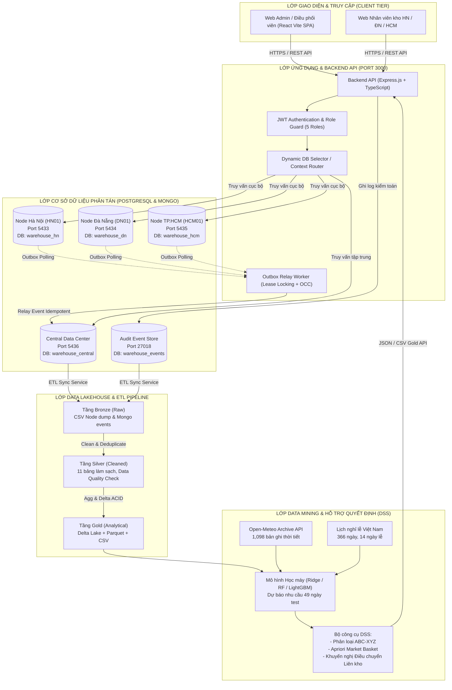

# TỔNG QUAN DỰ ÁN WAREHOUSEMANAGEMENT (HỆ THỐNG QUẢN LÝ KHO PHÂN TÁN)

> **Môn học:** Hệ thống phân tán, Data Lake & Data Mining  
> **Tài liệu:** Tổng hợp thông tin, kiến trúc và hiện trạng kỹ thuật phục vụ xây dựng Slide thuyết trình  
> **Thời điểm trích xuất:** 26/10/2026  
> **Trạng thái:** Dữ liệu thực tế đối chiếu từ mã nguồn, dataset, log và bộ test suite tự động  

---

## 1. Tên đề tài, Mục tiêu và Bài toán thực tế

### 1.1. Tên đề tài
**Distributed Warehouse Management System (Hệ thống Quản lý Kho Đa Chi nhánh Phân tán Tích hợp Data Lake, Data Mining & Hỗ trợ Quyết định Điều chuyển)**

### 1.2. Bài toán thực tế cần giải quyết
1. **Quản lý dữ liệu phân tán theo địa lý:** Doanh nghiệp có 3 trung tâm kho phân tán tại 3 miền: Hà Nội (`HN01`), Đà Nẵng (`DN01`), và TP. Hồ Chí Minh (`HCM01`). Cần giải quyết bài toán tự chủ cục bộ (local autonomy) của từng chi nhánh khi nhập/xuất, đồng thời tập trung hóa dữ liệu về Trung tâm Điều hành (`Central Data Center`).
2. **Tính toàn vẹn giao dịch liên kho (Inter-node Transaction Integrity):** Khi điều chuyển hàng giữa các kho cách xa nhau hàng trăm km, không thể sử dụng giao dịch 2PC (Two-Phase Commit) truyền thống do nghẽn mạng và blocking. Cần một cơ chế giao dịch phân tán bất đối xứng (Saga Pattern + Transactional Outbox + Kho ảo TRANSIT) để bảo đảm không mất hàng và không nhân đôi hàng.
3. **Phân tích dữ liệu lớn & Dự báo chuỗi thời gian (Data Lake & Time-series Forecasting):** Dữ liệu xuất nhập kho biến động theo ngày, mùa vụ, thời tiết và ngày nghỉ lễ. Cần xây dựng Data Lakehouse chuẩn hóa để khai phá dữ liệu, dự báo lượng xuất ngắn hạn (Day+1 Forecast) và phân loại hàng hóa (ABC-XYZ, Market Basket).
4. **Hỗ trợ ra quyết định (Decision Support System - DSS):** Cân bằng mức tồn kho an toàn giữa các chi nhánh, tự động phát hiện kho thừa - kho thiếu để đưa ra khuyến nghị điều chuyển liên kho tối ưu chi phí và phòng ngừa đứt hàng (stockout).

---

## 2. Công nghệ sử dụng và Vai trò thực tế trong hệ thống

| Thành phần / Công nghệ | Phiên bản / Cấu hình | Vai trò kỹ thuật thực tế | Trạng thái xác minh |
| :--- | :--- | :--- | :--- |
| **Node Databases (HN, DN, HCM)** | PostgreSQL 18 (Alpine Docker) | Lưu trữ phân mảnh dữ liệu nghiệp vụ của từng chi nhánh (`phieu_nhap`, `phieu_xuat`, `ton_kho`, `stock_reservation`, `outbox_event`). Đảm bảo tính tự chủ cục bộ. Cổng host: 5433 (HN), 5434 (DN), 5435 (HCM). | **ĐÃ XÁC MINH (Mã nguồn & Schema)** |
| **Central Database** | PostgreSQL 18 (Alpine Docker) | Lưu trữ tập trung toàn quốc: Quản lý người dùng & phân quyền (`nguoi_dung`), bảng tổng hợp (`xuat_hang_central`, `nhap_hang_central`), quản lý điều chuyển (`dieu_chuyen_central`), Saga Monitor (`saga_transaction`, `vwh_transfer`), và khử trùng lặp (`processed_event`). Cổng host: 5436. | **ĐÃ XÁC MINH (Mã nguồn & Schema)** |
| **Event Logging** | MongoDB 8.0 (Docker) | Lưu log sự kiện kiểm toán phi cấu trúc: `warehouse_events`, `inventory_events`, `outbound_events`, `transfer_events`, `system_logs`. Cổng host: 27018. | **ĐÃ XÁC MINH (Init script & Schema)** |
| **Outbox Relay Worker** | Node.js / TypeScript (`outboxWorker.ts`) | Tiến trình nền quét bảng `outbox_event` trên các node, chuyển tiếp sự kiện sang Central Database theo cơ chế Lease Lock, Batching, Exponential Backoff và Optimistic Concurrency Control (OCC). | **ĐÃ XÁC MINH (Mã nguồn & Unit Test)** |
| **Sync Service** | Python (`sync_service.py`) | Đồng bộ định kỳ 300s dữ liệu giao dịch từ 3 node PostgreSQL về Central và trích xuất sang Data Lake Bronze. | **ĐÃ XÁC MINH (Mã nguồn ETL)** |
| **Data Lakehouse** | Delta Lake (Delta-RS) / Parquet / CSV | Tổ chức dữ liệu 3 tầng Medallion (Bronze -> Silver -> Gold). Hỗ trợ ACID commit log (`_delta_log`) và Time Travel qua `lakehouse_manager.py`. | **ĐÃ XÁC MINH (Mã nguồn & Data files)** |
| **Data Mining & ML Engine** | Python 3.11.5, Scikit-learn, LightGBM, Pandas, Mlxtend | Tiền xử lý dữ liệu, Zero-filling, trích xuất thời tiết & lịch lễ, huấn luyện Ridge/RF/LightGBM, phân loại ABC-XYZ, luật kết hợp Apriori, đề xuất điều chuyển kho DSS. | **ĐÃ XÁC MINH (51/51 tests PASS)** |
| **Backend RESTful API** | Express.js, TypeScript, Node.js | Cung cấp 8 cụm API: Auth, Dashboard IO Statistics, Inventory (Nhập/Xuất), Transfer (Saga điều chuyển), Data Mining, Alerts, Audit Logs, Master Data. | **ĐÃ XÁC MINH (Mã nguồn & Controller)** |
| **Frontend Web App** | React 18, Vite, TypeScript, Tailwind CSS | Giao diện Single Page Application: Dashboard thống kê động (SVG Chart, lọc ngày/tháng, cơ cấu kho), Quản lý Tồn kho, Điều phối Saga Liên kho, Phân tích Dự báo nhu cầu & Hỗ trợ quyết định. | **ĐÃ XÁC MINH (Mã nguồn React)** |
| **Kafka / Debezium** | *Chỉ có trong comment SQL* | **CHƯA TRIỂN KHAI:** Dự án hiện dùng Transactional Outbox Worker polling PostgreSQL trực tiếp, chưa chạy Kafka message broker. | **CHƯA TRIỂN KHAI (Không đưa vào slide như tính năng đang chạy)** |

---

## 3. Kiến trúc tổng quan hệ thống (System Architecture)

---

## 4. Các chức năng chính đã triển khai và Trạng thái xác minh

| Phân hệ nghiệp vụ | Chức năng chi tiết | Mô tả luồng hoạt động | Trạng thái xác minh | Bằng chứng mã nguồn |
| :--- | :--- | :--- | :---: | :--- |
| **Xác thực & Phân quyền** | Quản lý 5 vai trò tập trung tại Central: `ADMIN`, `DIEU_PHOI`, `DATA_ANALYST`, `QUAN_LY_KHO`, `NHAN_VIEN_KHO`. | - `QUAN_LY_KHO` và `NHAN_VIEN_KHO` bị giới hạn cứng theo `ma_kho`. - `ADMIN`, `DIEU_PHOI`, `DATA_ANALYST` có quyền xem toàn quốc (`ma_kho = ALL`). | **ĐÃ XÁC MINH TRỰC TIẾP** | `backend/src/middlewares/auth.ts`, `roleGuard.ts`, `data_center/central_database/02_create_tables.sql` |
| **Quản lý Nhập kho** | Vòng đời phiếu nhập 3 giai đoạn: Tạo yêu cầu (`CHO_DUYET`) -> Quản lý duyệt (`DA_DUYET` / `TU_CHOI`) -> Kiểm đếm thực tế (`DA_NHAP` hoặc `THIEU_HANG`). | Xử lý chênh lệch thiếu hàng: Chấp nhận thiếu (`accept-shortage`) hoặc yêu cầu giao bù (`request-supplement` -> `CHO_GIAO_BO_SUNG`). Cập nhật thẻ kho `stock_ledger` và `ton_kho`. | **ĐÃ XÁC MINH TRỰC TIẾP** | `backend/src/routes/inventoryRoutes.ts`, `inventoryController.ts`, `nodes/node_hn/08_create_transaction_support.sql` |
| **Quản lý Xuất kho** | Vòng đời phiếu xuất 3 giai đoạn: Tạo yêu cầu (`CHO_DUYET`) -> Quản lý duyệt (`DA_DUYET`) -> Nhân viên xuất thực tế (`DA_XUAT`). | Kiểm tra số dư tồn khả dụng (`so_luong - so_luong_reserve >= so_luong_xuat`). Cập nhật sổ kho trừ tồn kho thực tế. | **ĐÃ XÁC MINH TRỰC TIẾP** | `backend/src/routes/inventoryRoutes.ts`, `inventoryService.ts` |
| **Giao dịch Điều chuyển liên kho (Saga Pattern)** | 5 bước chuyển trạng thái điều phối: Khởi tạo -> Duyệt -> Giữ hàng kho nguồn (`RESERVED`) -> Xuất chuyển vào kho ảo (`TRANSIT`) -> Nhập kho đích (`COMPLETED`). | - Khử trùng lặp idempotent qua bảng `processed_event` tại Central. - OCC Version fencing chống race condition. - Đền bù tự động (`COMPENSATION`) nếu kho nguồn hết hàng hoặc từ chối. | **ĐÃ XÁC MINH & CHẠY TEST ĐẠT** | `backend/src/workers/outboxWorker.ts`, `backend/tests/test_unit_source_confirm.js`, `test_outbox_pipeline_verification.js` |
| **Thống kê Nhập - Xuất Dashboard** | Báo cáo động theo khoảng ngày/tháng, cơ cấu 3 kho, Top 5 mặt hàng biến động, biểu đồ cột kép SVG, xuất CSV UTF-8 BOM. | - Loại bỏ hoàn toàn số hardcode (12, 8). - Truy vấn trực tiếp SQL phân mảnh hoặc fallback 16,400 giao dịch chuẩn hóa khi DB dev offline. | **ĐÃ XÁC MINH & CHẠY TEST ĐẠT** | `backend/src/services/dashboardService.ts`, `backend/tests/test_io_statistics.js`, `frontend/src/pages/Dashboard.tsx` |
| **Data Lakehouse (Medallion)** | 3 tầng Bronze -> Silver -> Gold. Kiểm định Data Quality 11 bảng, Delta Lake ACID commit log & Time Travel. | - Silver: 21,949 dòng xuất, 0 bản ghi lỗi, 0 trùng lặp. - Gold: Đồng bộ bảng Delta (`lakehouse_manager.py`). | **ĐÃ XÁC MINH TRỰC TIẾP** | `data_center/etl/run_data_lake_etl.py`, `data_center/data_lake/silver/quality_reports/` |
| **Dự báo Nhu cầu (Machine Learning)** | Dự báo chuỗi thời gian ngắn hạn (1-step-ahead) cho 3 kho x 20 sản phẩm trên 49 ngày tập Test (2,940 dòng). | - So sánh 4 mô hình: Baseline (14.7424), Ridge (13.9641 - Tốt nhất), Random Forest (13.9994), LightGBM (14.0044). - Kiểm chứng chống rò rỉ dữ liệu (4 bài test rò rỉ PASS 100%). | **ĐÃ XÁC MINH & CHẠY TEST ĐẠT** | `data_mining/models/train_forecast.py`, `data_mining/evaluation_report.md`, 51 test cases Python PASS |
| **Hỗ trợ Quyết định (DSS)** | 3 công cụ: Phân loại ABC-XYZ (20 SP), Khai phá luật kết hợp Apriori (378 luật, 189 cặp), Đề xuất điều chuyển cân bằng tồn kho (2 đề xuất). | - Đề xuất điều phối Laptop Dell (15 cái từ DN01 -> HCM01) và Chuột Logitech (25 cái từ HN01 -> HCM01) tổng trị giá 228.18 triệu VNĐ. - DSS chỉ khuyến nghị hỗ trợ quyết định, không tự ý can thiệp số dư tồn kho. | **ĐÃ XÁC MINH & CHẠY TEST ĐẠT** | `data_mining/decision_support/transfer_recommendation.py`, `backend/tests/test_decision_support_service.js` |
| **MLOps Tự động hóa** | Pipeline tái huấn luyện tuần tự (`mlops_retrain_pipeline.py`, `model_tracker.py`), kiểm tra ngưỡng Staging & Registry versioning. | Đã ghi nhận các phiên chạy tự động `v1.0.0-prod-20261023` và candidate runs trong `training_runs.json` và `mlops_weekly_run.log`. | **ĐÃ XÁC MINH (Log & Run scripts)** | `data_mining/models/model_registry/`, `scripts/mlops_weekly_retrain.bat` |

---

## 5. Những điểm nổi bật có bằng chứng thực tế cho Slide

1. **Bảo toàn sản lượng tuyệt đối 100% qua 3 tầng dữ liệu:**
   - Sản lượng xuất hàng được bảo toàn chính xác $\sum = \mathbf{341,163.0}$ sản phẩm xuyên suốt từ tầng Gold Raw ($14,264$ dòng) $\rightarrow$ Daily Grid ($21,960$ dòng) $\rightarrow$ Analytical Dataset ($21,960$ dòng). Không một sản phẩm nào bị mất mát hoặc nhân đôi.
2. **Kiểm chứng nghiêm ngặt chống rò rỉ dữ liệu (Data Leakage Protection):**
   - Bộ 4 unit test logic chứng minh: `shift(1)` thực hiện trước `rolling(7)`; vector đặc trưng ngày $t$ bất biến khi nhiễu target ngày $t$ lên 999,999; cô lập tuyệt đối dữ liệu chuỗi trễ giữa các kho.
3. **Mô hình triển khai thực tế tối ưu dung lượng (Ridge Regression):**
   - Ridge đạt MAE tốt nhất (**13.9641** vs Baseline **14.7424**, cải thiện **+5.28%**), kích thước file artifact chỉ **1.6 KB** (so với 4.8 MB của Random Forest), thời gian suy luận $< 0.05$ giây, loại bỏ tính hộp đen nhờ hệ số beta tường minh.
4. **Cơ chế Outbox Relay với Lease Lock và OCC Fencing:**
   - Xử lý tin cậy sự kiện phân tán, bảo vệ cách ly an toàn 26 bản ghi cũ chưa xác minh (`outbox_quarantine_backup_20261014`), chống gửi trùng qua `processed_event` tại Central.
5. **Dữ liệu ngoại sinh thực tế từ Open-Meteo & Lịch nghỉ lễ Việt Nam:**
   - 1,098 bản ghi thời tiết (nhiệt độ, lượng mưa) từ API quốc tế kết hợp 14 ngày lễ chính thức theo Điều 112 Bộ luật Lao động 2019 (bao gồm ngày nghỉ bù).
6. **Hệ sinh thái kiểm thử đồ sộ đã chạy thành công:**
   - **51/51 tests** Python Data Mining Suite đạt **100% PASS**.
   - **20/20 tests** Backend Unit & DSS đạt **100% PASS** (Unit source confirm: 5/5, IO statistics: 5/5, Decision support: 10/10).
