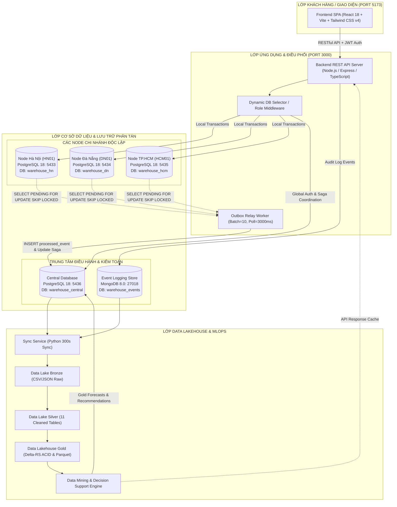
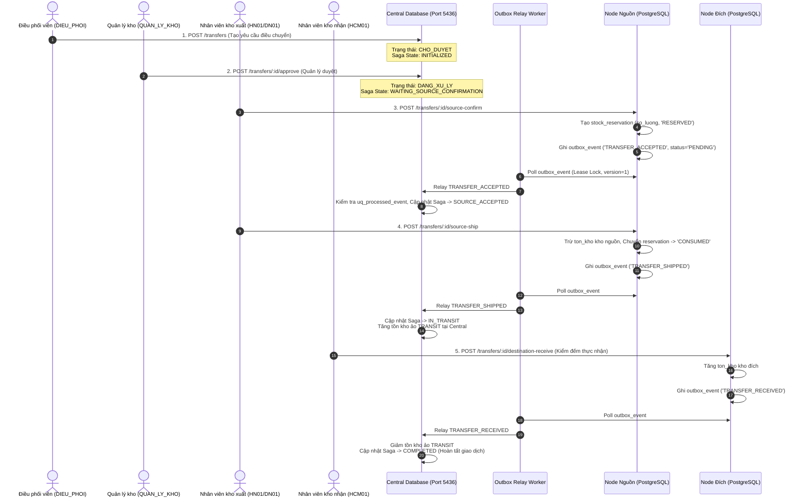
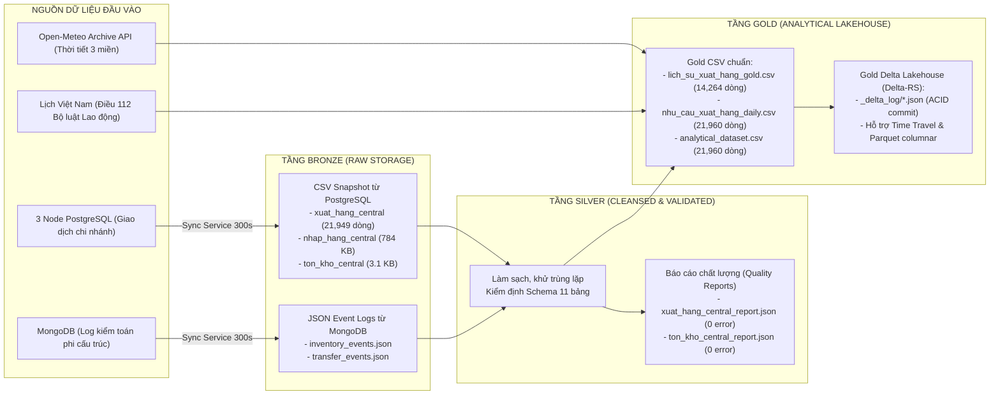
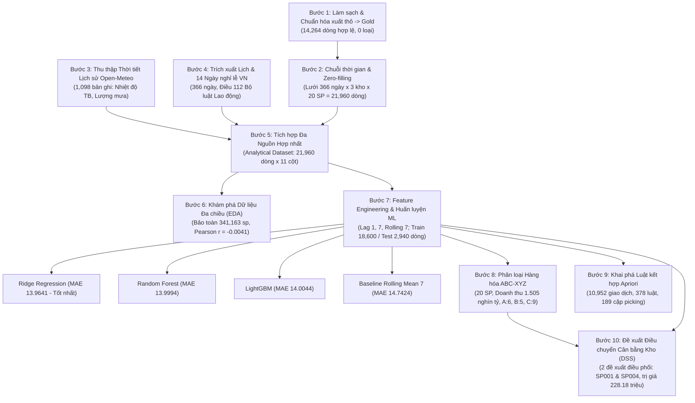

# KIẾN TRÚC HỆ THỐNG VÀ CÁC LUỒNG NGHIỆP VỤ THỰC TẾ

> **Tài liệu:** Bóc tách chuyên sâu kiến trúc phân tán, giao dịch Saga, luồng ETL Data Lake và Data Mining  
> **Dự án:** WarehouseManagement  
> **Vị trí file:** `presentation_materials/03_architecture_and_flows.md`  

---

## 1. Kiến trúc Hệ thống Phân tán Thực tế

Hệ thống được thiết kế theo mô hình **Database-per-Node** kết hợp **Central Data Center** và **Event Store** phi cấu trúc:



### 1.1. Phân chia trách nhiệm giữa các Node
1. **Các Node Chi nhánh (`HN01`, `DN01`, `HCM01`):**
   - **Tự chủ nghiệp vụ (Local Autonomy):** Thực thi giao dịch nhập hàng, xuất hàng, kiểm kê tại chỗ mà không phụ thuộc vào tình trạng kết nối tới Central hay các node khác.
   - **Bảng dữ liệu phân mảnh:** `phieu_nhap`, `ct_phieu_nhap`, `phieu_xuat`, `ct_phieu_xuat`, `ton_kho`, `lich_su_ton_kho`.
   - **Thành phần hỗ trợ phân tán:**
     - `stock_reservation`: Khóa mềm số lượng hàng (`RESERVED`) phục vụ điều chuyển, bảo đảm không bị xuất bán mất trong khi xe chưa tới lấy hàng.
     - `outbox_event`: Bảng sự kiện cục bộ ghi nhận các thay đổi nghiệp vụ cần thông báo ra ngoài, bảo đảm giao dịch cơ sở dữ liệu và ghi log diễn ra trong cùng một ACID transaction.
2. **Central Data Center (`warehouse_central`):**
   - **Quản lý danh mục & phân quyền tập trung:** Bảng `kho`, `nguoi_dung` (5 roles: `ADMIN`, `DIEU_PHOI`, `DATA_ANALYST`, `QUAN_LY_KHO`, `NHAN_VIEN_KHO`).
   - **Kho ảo TRANSIT:** Quản lý hàng hóa đang trên đường vận chuyển giữa các tỉnh thành (`loai_kho = 'VIRTUAL'`).
   - **Saga Orchestrator & Monitoring:** Bảng `saga_transaction`, `saga_monitoring`, `vwh_transfer`, `transfer_discrepancy`.
   - **Khử trùng lặp sự kiện (Idempotency Barrier):** Bảng `processed_event` lưu vết các `event_id` đã xử lý thành công, ngăn chặn việc xử lý lặp lại khi mạng bị chập chờn hoặc worker retry.
3. **Audit Event Store (`warehouse_events` - MongoDB):**
   - Lưu trữ phi cấu trúc các sự kiện: `warehouse_events`, `inventory_events`, `outbound_events`, `transfer_events`, `system_logs`.
   - Cung cấp dữ liệu truy vết kiểm toán dòng đời hàng hóa (Traceability & Compliance).

---

## 2. Giao dịch Phân tán và Luồng Saga Điều chuyển Hàng (Distributed Saga)

### 2.1. Bản chất nghiệp vụ và Giải pháp Saga
Khi điều chuyển 15 chiếc Laptop Dell từ Đà Nẵng (`DN01`) ra TP. Hồ Chí Minh (`HCM01`), khoảng cách hơn 900 km và thời gian vận chuyển kéo dài từ 2 đến 3 ngày. Hệ thống **không thể giữ kết nối mạng mở (blocking connection)** giữa 2 database trong suốt 3 ngày.

**Giải pháp:** Áp dụng **Saga Pattern (Orchestration-based)** kết hợp **Kho ảo trung gian (`TRANSIT`)** và **Transactional Outbox Worker**.

### 2.2. Chi tiết 5 bước của luồng Saga



### 2.3. Cơ chế Outbox Polling Relay & Kiểm soát đồng thời (OCC Fencing)

1. **Quét và Khóa hàng độc quyền (Exclusive Lease Lock):**
   - Outbox Worker sử dụng câu lệnh SQL chuẩn:
     ```sql
     SELECT event_id, aggregate_id, event_type, payload, version, retry_count
     FROM outbox_event
     WHERE status = 'PENDING' AND next_retry_at <= CURRENT_TIMESTAMP
     ORDER BY created_at ASC
     LIMIT 10
     FOR UPDATE SKIP LOCKED;
     ```
   - Cơ chế `FOR UPDATE SKIP LOCKED` giúp nhiều luồng/worker chạy song song mà không bao giờ tranh chấp hay khóa chết (deadlock) lẫn nhau.
2. **Khóa lạc quan chống Race Condition (OCC Version Check):**
   - Khi cập nhật trạng thái sự kiện sang `PROCESSED`:
     ```sql
     UPDATE outbox_event
     SET status = 'PROCESSED', version = version + 1, processed_at = CURRENT_TIMESTAMP
     WHERE event_id = $1 AND version = $2;
     ```
   - Nếu một worker khác đã can thiệp khiến `version` thay đổi, câu lệnh trả về `rowCount = 0` và tiến trình lập tức hủy bỏ lượt xử lý để bảo đảm an toàn.
3. **Khử trùng lặp Idempotent tại Central Database:**
   - Central Database lưu giữ bảng `processed_event` với khóa chính `event_id UUID`.
   - Nếu worker gửi lại một sự kiện cũ do timeout mạng, Central kích hoạt cơ chế `ON CONFLICT (event_id) DO NOTHING` hoặc trả cờ `IDEMPOTENT_IGNORED`, cam kết tuyệt đối không nhân đôi giao dịch.
4. **Cơ chế Đền bù (Compensation Logic):**
   - Nếu tại Bước 3 kho nguồn kiểm tra tồn kho thấy không đủ hàng, hệ thống phát sinh sự kiện `TRANSFER_REJECTED`.
   - Central Saga chuyển sang trạng thái `REJECTED`, tự động kích hoạt procedure hủy phiếu, không thực hiện trừ kho và thông báo lý do thiếu hàng về màn hình Điều phối viên.

---

## 3. Kiến trúc Data Lakehouse và Luồng ETL

Hệ thống triển khai mô hình **Medallion Lakehouse 3 tầng** chuẩn hóa:



### 3.1. Đặc điểm các tầng dữ liệu thực tế
- **Tầng Bronze (Raw):** Trích xuất nguyên bản không qua chỉnh sửa cấu trúc từ Central PostgreSQL và MongoDB.
- **Tầng Silver (Cleaned):**
  - Thực thi kiểm định chất lượng nghiêm ngặt qua 11 file báo cáo độc lập (`data_center/data_lake/silver/quality_reports/`).
  - Kết quả kiểm định thực tế trên bảng quan trọng nhất `xuat_hang_central`: **21,949 dòng vào = 21,949 dòng ra; 0 dòng bị loại (rejected = 0); 0 dòng trùng lặp**.
- **Tầng Gold (Analytical & Lakehouse):**
  - Tổng hợp dữ liệu theo đơn vị chuẩn: `(ngay, ma_kho, ma_sp)`.
  - Lưu trữ đồng thời dưới dạng CSV chuẩn hóa và bảng **Delta Lakehouse (Delta-RS)** có transaction log, cho phép truy vấn Time Travel theo phiên bản `version=0`, `version=1` phục vụ kiểm toán dữ liệu lớn.

---

## 4. Pipeline Khai phá Dữ liệu & Hỗ trợ Quyết định (Data Mining & DSS)

Quy trình tự động hóa 10 bước khép kín thực thi qua `data_mining/run_pipeline.py`:



### 4.1. Đặc trưng đầu vào của Mô hình Machine Learning (31 Features)
1. **Đặc trưng độ trễ chuỗi thời gian (Lags):** `lag_1` (lượng xuất hôm trước), `lag_7` (lượng xuất cùng thứ tuần trước).
2. **Đặc trưng thống kê trượt (Rolling Stats):** `rolling_mean_7` (trung bình trượt 7 ngày quá khứ tính bằng `shift(1).rolling(7).mean()`).
3. **Đặc trưng ngoại sinh (Thời tiết & Lịch lễ):** `nhiet_do_tb`, `luong_mua`, `thu_trong_tuan`, `la_cuoi_tuan`, `la_ngay_le`.
4. **Biến định danh One-hot Encoding:** 3 biến kho (`ma_kho_DN01`, `ma_kho_HCM01`, `ma_kho_HN01`) và 20 biến sản phẩm (`ma_sp_SP001` đến `ma_sp_SP020`).

### 4.2. Cơ chế Hỗ trợ Quyết định (Decision Support System - DSS)
- Thuật toán Heuristic trong `transfer_recommendation.py` tính toán:
  - **Mức tồn an toàn mục tiêu:** $\text{Target Stock} = \text{Dự báo nhu cầu 14 ngày} + \text{Đệm an toàn (Safety Buffer)}$.
  - **Số ngày đáp ứng tồn kho (Days of Supply - DOS):** $\text{DOS} = \frac{\text{Tồn hiện tại}}{\text{Dự báo xuất ngày TB}}$.
  - **Ghép cặp điều chuyển:** Lấy từ kho thặng dư cao ($\text{DOS} > 30$ ngày) chuyển sang kho nguy cơ đứt hàng ($\text{DOS} < 10$ ngày), tự động làm tròn lô đóng gói 5 sản phẩm.
- **Nguyên tắc phân định ranh giới hệ thống:** DSS chỉ đóng vai trò **khuyến nghị thông minh (Advisory)** trên giao diện cho Điều phối viên xem xét, **tuyệt đối không tự động tạo phiếu điều chuyển và không tự ý thay đổi số dư tồn kho**.
